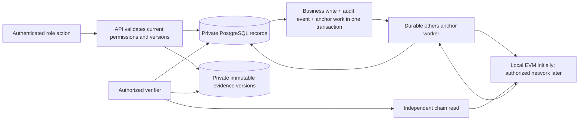

# Blockchain integration research for the DSWD pivot

Date: 2026-10-10. Repository inspected at commit 0880b27, on the existing pivot/ideation branch.

**Status: research and recommendations; no implementation approved or performed.** Existing pivot decisions retain their status. Recommendations below do not expand version 1, select an authentication provider on the maintainer's behalf, or authorize a schema, receipt format, contract or deployment change.

## 1. Purpose and conclusion

The maintainer asked for an investigation of the existing pivot against the original hackathon project, a concrete way to integrate blockchain, and a suggested stack. The maintainer confirmed that the existing pivot documents should govern the research and invited suggestions. The referenced PRD and ERD are absent. The [decisions record](../decisions-2026-10-08.md), [process](../process.md), [pivot DFD](../dfd.md), five role documents and funds drafts provide the available product context.

**Recommendation:** retain the hybrid architecture and use blockchain as an independently readable witness to immutable evidence versions. Anchor the documented funding basis, submitted and approved lists, recorded handovers, and subsequent private outcome commitments. Keep cash, identity, eligibility decisions, permission enforcement and the payout state machine in the application.

This preserves the useful part of the hackathon project while correcting its claim that a matching receipt hash proves a family received the money. The strongest pivot benefit is an auditor being able to establish **which evidence, list and amount basis existed for a recorded decision**, and detect replacement after anchoring.

The pivot already defines a blockchain commitment inventory and failure rules in decisions 16.23–16.25. Its missing pieces are implementation boundaries, serialization, transaction recovery, finality policy, independent verification, key custody, costs and deployment governance. The screen mockup is explicitly simulated and has no live chain, authentication, files, API or SMS integration.

For the current one-Field-Office scope, use a small EVM registry with a private PostgreSQL application and a durable anchor worker. Validate locally first; Polygon Amoy is a candidate for an explicitly labelled test deployment. Consider a permissioned consortium only when independently operated agencies actually join. No public-network deployment was performed by this research.

## 2. What the original project actually has

The comparison uses the running backend's source, rather than treating README claims or the unused FastAPI backend as implemented behavior. Sources: [current user flow](../../product/user-flow.md), [current DFD](../../system/dfd.md), [server](../../../backend/server.py), [blockchain service](../../../backend/app/services/blockchain.py), [CLI adapter](../../../contracts/scripts/blockchain_client.js), [contract](../../../contracts/contracts/AyudaChainRegistry.sol), [receipt hasher](../../../backend/app/services/hasher.py), and package manifests.

| Area | Original hackathon implementation | Existing pivot | Integration consequence |
|---|---|---|---|
| Funding path | Release → barangay allocation → distribution assertions | Document-backed Field Office releases; direct DSWD cash payout | Barangay allocations must not become a pivot budget step. A release is funding authority, not a bank transfer or certified cash. |
| Roles | Browser-selected Citizen, Barangay Officer and Auditor; API has no authenticated permissions | Five roles; DSWD decides, barangay attests, recipient authorizes, separate officer hands over, Auditor reads | Authentication and server authorization establish attribution; a chain operator address does not identify a human officer. |
| Scope | One hardcoded disaster; beneficiary and payout demo | Seeded disasters in one Field Office; one entitlement/handover per household/disaster | New opaque, versioned identifiers and entitlement uniqueness must replace timestamp/truncated-string identifiers. |
| Amount | Officer submits an editable amount; fixed ₱5,000 anomaly baseline | Documented formula or fixed category inputs; computed amount; unpaid revisions, paid amounts locked | Commit the input version and entitlement/list version, not only a number on a receipt. |
| Claims | Registration and fuzzy comparisons; some records auto-marked VERIFIED | Human eligibility decisions; local automatic checks only raise flags; National ID check simulated | Keep these checks off-chain. Hashing cannot make an incorrect identity or affectedness assessment true. |
| Lists | No submitted/approved immutable-list workflow | Signed barangay snapshot or labelled system fallback; versioned approved list | These snapshots provide the missing chain of evidence before payout. |
| Payout evidence | One officer assertion and sample receipt/OCR text | Recipient opens and authorizes; officer records handover; recipient separately answers | Handover and outcome need separate commitments. A dispute never restores a payable entitlement. |
| Corrections | Business rows are mutable/deletable; reset clears the audit log | Reversal/replacement, appended replies, snapshots and outcome versions | Correct by adding new versions and links; never replace an anchored payload. |
| Failures | Fabricated transaction hashes and positive verification fallback | Explicit pending, failed, missing, mismatch and unreachable states | Save business facts independently, retry the same commitment, and verify against actual chain reads. |
| Connectivity | Offline toggle has no queue | No offline payout; officer provides connection | Background chain submission is useful, but is not an offline cash authorization mechanism. |
| Disclosure | Public APIs expose household records; off-chain does not imply private | Resident-scoped list, restricted identity evidence, private grievances | Publish commitments with private evidence/projections, rather than moving the existing public API onto a chain. |

### Reusable implementation and material gaps

1. Retain the Next.js/React/TypeScript UI foundation, Solidity/Hardhat tooling, ethers integration knowledge, and SHA-256 evidence concept. The fuzzy matching functions can inform the pivot's plain automatic checks; the fixed-grant anomaly rules do not establish pivot eligibility or correctness.
2. The existing contract already implements **anchorRecord(recordId, recordHash, recordType)** and the **anchoredRecords** getter. It prevents reusing a record ID and accepts an authorized operator. This is a viable primitive for a local proof of evidence anchoring.
3. The CLI and Python service do not expose that generic primitive. They currently offer release, allocation, distribution and receipt verification. The blockchain specification omits the generic function: a code/documentation discrepancy to address when the adapter or contract documentation is changed.
4. The generic anchor does not carry a clear amount/disaster field, reject a zero record hash, encode correction direction, enforce version lineage or validate private workflow permissions. Those are limitations, not reasons to pretend it is a complete pivot registry.
5. The legacy release function accepts positive amounts and has no evidence hash. The distribution function requires a legacy funding batch and exposes an amount/beneficiary reference. It does not establish once-only consumption per household/disaster: the contract's uniqueness is by distribution ID.
6. The adapter truncates textual IDs to 31 characters before bytes32 encoding. The pivot needs collision-resistant opaque IDs without truncation. It also uses parseEther for recorded peso amounts, an undocumented 18-decimal convention. A new protocol should specify integer centavos explicitly while preserving legacy interpretation.
7. The service's eight-second subprocess timeout can occur after a real submission. Killing the process and losing its transaction reference creates an uncertain result; a retry must reconcile the chain, rather than assume failure.
8. Receipt hashing commits normalized text and selected IDs/amount/method. It does not hash original file bytes or include the household name. The browser's name-swap scenario therefore overstates the actual hash coverage.

The [architecture document](../../system/architecture.md) also describes FastAPI/PostgreSQL as if they were the running backend, while the root scripts start the standard-library server with SQLite. Its receipt-authenticity and guaranteed-cheap-gas wording exceeds what the code establishes. These are reported findings; no existing behavior or document was rewritten by this research.

## 3. Where blockchain adds value, and where it does not

| Threat or audit question | Useful proof | Remaining dependency |
|---|---|---|
| An uploaded source file or confirmed release fields are replaced | Original-byte digest and confirmed-entry commitment can be rechecked | Authenticity of the document at upload, issuer signatures and human confirmation |
| A submitted list is altered or a fallback is relabelled as barangay endorsement | Typed, immutable snapshot commits actual sender/status/resolution references | Correct account identity and authorization at submission |
| Names/categories/entitlements change after publication | Versioned private list commitment identifies the original snapshot; successor preserves history | Correct initial eligibility and current application authorization |
| A payout amount is justified with a different formula later | Receipt links to the exact input and entitlement/list versions | Correct source inputs and calculation implementation |
| A recorded handover or later shortfall answer is overwritten | Distinct immutable handover and outcome commitments | Truth of physical exchange; recipient/payer/checker independence |
| Database administrator replaces already anchored content | Independent auditor recomputes and compares the known commitment | Evidence availability, trustworthy chain/RPC access, and discovery of all relevant anchors |
| A private grievance note or session amendment disappears | Normal append-only database controls and external backups help | Such records have no standalone anchor in the settled inventory; do not claim cryptographic coverage of every audit row |

Public anchoring supplies an external history of submitted commitments. It does not prove that every real-world action was recorded or prevent a compromised collector from submitting false new content. A hash proves continuity of specified content, not truthful affectedness, a genuine handwritten signature, absence of collusion, or physical receipt of cash.

**Attribution is a prerequisite, not a blockchain feature.** Version 1 explicitly defers sign-in. Keep that decision visible: a role-preview version can demonstrate integrity, but cannot credibly attribute an entry to a real officer. I recommend authenticated staff accounts before any real-record pilot. That is a proposed scope change, not a retroactive change to the decided version 1. The five-role process already identifies authentication as required.

“Signed barangay batch” also needs precise language. An authenticated submission with an uploaded council resolution is not automatically a cryptographic signature from the Punong Barangay. Optional actor signing is a later assurance layer; the service wallet's signature proves the anchoring service submitted the transaction. Legal recognition of application records/signatures was not established by this research.

## 4. Architecture options

| Option | What it offers | What must exist | Assessment for this pivot |
|---|---|---|---|
| Signed append-only database with independent copies/checkpoints | Low operational burden; accountable application history | Separate witness/copy custody to resist an administrator rewriting and re-signing history | Useful baseline and fallback architecture. A local database alone lacks the external witness the blockchain objective seeks. |
| Private application + public EVM commitments | Publicly readable external commitments, familiar existing tooling, separate private evidence | Gas budget, signer custody, RPC availability, privacy review, and evidence retention | **Recommended integration direction** for the one-office proof and possible pilot; local first, testnet only when authorized. |
| Permissioned Fabric consortium | Organizational membership, endorsement policies and private collections | Independent agency operators, identity infrastructure, governance, upgrade and recovery agreements | Reconsider when agencies commit to operating it. Multiple nodes run by one project team do not create independent institutional oversight. |

Fabric supports organizational private-data/endorsement policies; this is a real capability, not a reason to rule it out. Its documentation also warns that predictable private values can be guessed from hashes. [Fabric private data](https://hyperledger-fabric.readthedocs.io/en/latest/private-data-arch.html).

WFP's Building Blocks is evidence that privately managed humanitarian blockchain coordination can be useful across organizations. It is not proof that AyudaChain should reproduce its network or benefits with one writer. The primary-source companion provides the precedent and governance evidence.

Keep fiat cash distribution outside smart contracts. Introducing a token, stablecoin, wallet for every household, automated eligibility or smart-contract escrow would change the product and add custody/settlement issues without solving its present evidence problem.

## 5. Fit the existing commitment inventory

This translates [the consolidated commitments](../process.md#consolidated-commitments); it does not add new mandatory anchors. Each supporting-document version gets a document commitment and is referenced by its business envelope. Shared evidence used in a linked correction is referenced rather than counted as a fresh release.

| Pivot event | Immutable private content to commit | Safe chain representation | Business consequence of anchor failure |
|---|---|---|---|
| F4–F5 release and evidence | Original file digests; machine-read/confirmed fields; source, signatory-as-printed and actor references | Entry/document commitment IDs and hashes; for fund entries, opaque disaster reference and recorded amount | Entry counts immediately; explicit missing/failed/partial anchoring exception |
| F7 correction | Correction-set ID, original reference, reason, reversal/replacement, reused/new evidence | New linked commitment IDs; recorded fund amounts with unambiguous correction direction | Database correction is atomic; all original/new content retained; partial anchor failure visible |
| C12/C15 amount inputs | Mode, wage/fixed-category values, duration/category rules, evidence and prior input version | Input/document commitments and opaque context | Calculation/business version retained; required missing anchors visible |
| C6 signed barangay batch | Claim/response versions, actual sender/position, resolution digest, submission time | Batch commitment and resolution commitment; fixed type identifying actual submission | Claim still reaches DSWD; retry unchanged snapshot |
| C7/C10 fallback | Actual claims/responses, missing-submission/response/eligible-endorser reason, system origin | Separate fallback commitment/type; no manufactured signature/resolution | Route to DSWD continues; explicit failure retained |
| C13/C14/C15 approved list | Frozen private identity projection, claim/decision/category, computed entitlement/input versions, list version | List hash initially; optional Merkle root and private leaf proofs later | List remains pending publication until its own required anchor is confirmed |
| P7 handover | Transaction/attempt, entitlement/input/list/session versions, locked amount, payer/account references and authorization result | Handover commitment and opaque linkage; personal amount remains in private content under the settled boundary | Handover remains consumed; failed anchoring never authorizes another payment |
| P8–P10 outcomes | Full/less/not received, timeout or revised answer; recorder, prior event and transaction references | Randomized private outcome commitment; neutral common type, opaque linkage | Outcome and any grievance remain saved; retry same event, no repeated handover |

Individual nominations, registry edits, claim responses, checks/decisions, challenges, grievances, sessions, attempts, notifications and Auditor access logs stay off-chain. Snapshot proofs cover the specific versions they include. A later reply outside a snapshot is not silently covered by the older anchor.

The settled publication gate explicitly requires the list's confirmed anchor, computed entitlements and current business versions. Other required anchors can fail independently. A stricter rule requiring every referenced document/input/batch anchor before publication could improve assurance, but would be a **new product decision** and must not be quietly introduced.

## 6. Evidence formats and privacy

### Proposed versioned commitment protocol

Define a new envelope version before implementation. It should bind a fixed domain/version, record kind, opaque record/version IDs, disaster context, prior/related commitments, relevant actor/account and event time, frozen business content, evidence byte digests, and a fresh private random nonce where disclosure is sensitive. Preserve the exact canonical bytes and nonce for retries and verification.

Use SHA-256 for original file bytes and canonical business-envelope commitments. Document the exact JSON canonicalization and cross-language test vectors. RFC 8785 describes deterministic JSON serialization and recommends strings for numbers beyond interoperable precision; sorted Python JSON alone is not a complete cross-language protocol. Use integer centavos in storage/chain amount fields and an explicitly defined decimal-string representation where needed in JSON. Reject ambiguous values and preserve Unicode as specified. [RFC 8785](https://datatracker.ietf.org/doc/html/rfc8785).

Do not hash only OCR text as the document proof. OCR/extraction results are separate evidence, may change with extraction tools, and must be confirmed by a human. A file-byte change should fail the original-file check even when normalized extracted text stays the same.

An envelope can commit a household name/identity **privately** without publishing it. A list proof should therefore bind the frozen identity version as well as the category and amount basis. This closes the legacy name-coverage gap without placing names on-chain.

### Private commitments need more than opaque labels

Outcome answers have only a few possibilities. Hashing just the answer, known transaction ID and amount permits guessing. Use a fresh cryptographically random nonce of at least 256 bits in each private envelope; disclose it only to authorized verifiers. Keep raw document digests private when they would enable sensitive linkage, and anchor a randomized envelope committing that digest. Duplicate-document detection can still compare raw digests privately.

This privacy design is an inference from Fabric's documented warning about guessable hashed private values; the exact serialization and privacy policy remain proposed. Never hash a National ID or phone number directly as a public identifier. Never include even hashed payout codes or low-entropy PINs in evidence commitments: retain only authorization method/result and permitted audit metadata. Secrets need their own credential controls.

Use random public record handles instead of predictable DFC numbers or reusable household identifiers. All outcome answers use the same non-personal record type; no public type such as SHORTFALL identifies a complaint. Public chain linkage/timing can still reveal that an event occurred and permit correlation. If hiding even the existence/timing of an answer is required, evaluate batched/delayed outcome commitments as a separately approved privacy change.

The Philippine Data Privacy Act distinguishes personal and sensitive information and specifies processing/security obligations. Keeping identifiers off-chain is one architecture measure; it does not itself establish legal compliance or settle resident-list disclosure, retention, hosting or agency authority. Those remain implementation-policy questions. [National Privacy Commission: RA 10173](https://privacy.gov.ph/data-privacy-act-/).

### Whole-list hash first; Merkle proofs when needed

A whole-list commitment is simplest for version 1's pattern and the first full-flow implementation. An authorized Auditor can recompute it from the complete private snapshot. A household otherwise has to trust the app's statement that its displayed entitlement belongs to the list.

If independently verifiable household inclusion is required, use a Merkle tree of randomized, versioned entitlement leaves and supply each household only its own payload/nonce and sibling hashes. Commit the root together with the list envelope, input/version references and defined tree format. Distinguish SHA-256 evidence hashing from any Keccak-based Merkle encoding and test interoperability.

An inclusion proof establishes membership in a committed snapshot. It does not establish current eligibility, absence of other claims, truth, or that an entire history remained append-only. Inclusion and consistency proofs answer different questions. [RFC 9162](https://www.rfc-editor.org/rfc/rfc9162.html).

An optional periodic checkpoint of all business audit events would extend cryptographic coverage to non-anchored records. It is **proposed, outside the settled inventory**; keep Auditor access logs separate so inspection activity is not exposed to the Field Office. Independently retained evidence/anchor inventories are also necessary to discover omissions or withheld history.

## 7. Contract reuse and compatibility

**Local feasibility path:** expose the existing generic anchor/getter in an isolated adapter and use new record-version IDs and safe types. Show a real saved-file/envelope → anchor → read → mismatch journey. No Solidity change is needed for that primitive. This would require later implementation authorization; no adapter was written here.

**Full pivot recommendation:** a separately versioned minimal evidence registry alongside the legacy deployment, with a generic commitment operation plus an explicit fund-entry representation. Fund entries need amount, opaque disaster/entry references and unambiguous reversal/replacement linkage/direction. Other commitments need hash/version context without exposing personal payloads. The exact ABI/storage is a proposed design task, not finalized in this report.

This distinction matters: the generic anchor alone proves an envelope containing the amount, but does **not** satisfy the pivot's decided clear on-chain fund-amount boundary. Combining legacy positive release records with separate metadata commitments may prove ordinary releases, but reversal semantics still need a decision. Do not silently downgrade the policy to hash-only amounts or misuse barangay allocations to represent corrections.

The new registry should reject empty IDs/hashes and duplicate immutable version IDs, restrict submissions, expose public read/event discovery, and define parent/version relationships where enforced. It should not try to inspect private eligibility, receipt answers or code/PIN validity. Database transactions enforce the payout process; the chain witnesses submitted content. On-chain uniqueness by a fabricated new record ID is not duplicate-payment prevention.

Preserve legacy receipt hashing and existing deployments. A new receipt/envelope protocol needs an ADR, explicit version routing, old-record verification and tests on both sides. A deployment registry binds chain ID, contract address, ABI/version and first block; never query a different contract/network after failure. Generated deployment artifacts must come from the deployment script, not hand edits. Every actual contract/payload/schema/dependency change and any non-local deployment requires the repository's separate maintainer decision.

Use a service-held operator signer for anchoring, with fees paid by the application, not recipients. Separate application accounts from blockchain operators. Document signer rotation and compromised-key response; historical commitments remain readable after revocation. A multisig or separate administrative custody can govern operators later without making the Auditor an approver of operational payouts.

## 8. Durable anchoring and verification

1. Upload evidence privately, hash original bytes and retain its immutable storage version. Confirm extracted fields. Freeze the business envelope only after permission/version validation.
2. In one database transaction, save the business event, append audit history, and enqueue immutable anchor work. Publication remains pending; a release or recorded handover keeps its specified business state.
3. A separate worker leases queued jobs with recovery after a crash. Use PostgreSQL locking/leases and serialize nonce allocation per signer; multiple API replicas must not independently submit the same commitment. PostgreSQL documents SKIP LOCKED for queue-like consumers, not for general consistent business reads. [PostgreSQL SELECT](https://www.postgresql.org/docs/current/sql-select.html).
4. Persist submission/nonce/recovery data before losing control to the network. On timeout, inspect any known transaction and the registry entry before retrying. Rebroadcast/reconcile the same content; if the same ID already holds a different hash, raise a conflict. At-least-once job delivery must produce one immutable record, not a second business event.
5. Record real RPC-returned transaction references and receipt status, block number/hash and deployment identity. A submitted transaction is not yet a confirmed anchor. ethers wait defaults to one included block; it does not by itself establish the chosen finality policy. [ethers transaction documentation](https://docs.ethers.org/v6/single-page/#api_providers__TransactionResponse).
6. For Polygon, verify successful canonical inclusion and use the finalized block boundary plus a matching getter read at the chosen verified block. Polygon documents Heimdall v2 milestone finality and the finalized RPC tag; Ethereum checkpoints are separate. Reported typical timing is not an application SLA. Confirm the selected RPC/network supports the policy. Local Hardhat needs a separately labelled development confirmation policy. [Polygon finality](https://docs.polygon.technology/pos/concepts/finality/finality).
7. On confirmation, append anchor completion and apply the list-publication gate using the unchanged snapshot and current business versions. Do not publish a snapshot that became stale while its anchor was pending.
8. A verifier fetches permitted original evidence/envelope bytes, recomputes the defined commitment, and reads the correct registry independently. Show MATCH, MISMATCH, REQUIRED ANCHOR ABSENT, CHAIN UNREACHABLE, or EVIDENCE UNAVAILABLE. Keep submission/finality state separate from current verification results; a historical match is not a current successful read.

Store retry/anchor history as append-only events even if a mutable queue projection tracks the next attempt. Errors and retries never resave a release, re-consume a code, restore a handed-over entitlement, or create another payment.

**Payout availability:** the recipient/payer needs a working authenticated application connection and current published authorization. A subsequent chain outage may delay a receipt anchor without reopening the handover. A background anchor queue is not an offline payout queue. The current process does not require a fresh chain transaction for every pre-handover step.

**Independent verification:** the minimum useful facility is an authorized evidence bundle and a read-only verifier using a pinned deployment and an independent RPC. A transaction link alone does not verify the local file. Auditor queries do not submit transactions or create Field Office-visible inspection logs. Operational administrators/RPC providers may still observe access metadata; the role-level access rule is not anonymity from all infrastructure operators.

## 9. Suggested stack

The choices below are recommendations for a future implementation, not new installed dependencies or commitments to a cloud vendor. Prefer the existing languages/tooling and one authoritative business API.

| Layer | Recommendation | Reason and qualification |
|---|---|---|
| Web | Next.js App Router, React, TypeScript, Tailwind; responsive web app | Existing UI foundation. Use a supported, patched release at implementation time. Private views must not be publicly cached. Browser role selection cannot authorize access. |
| Business API | Python FastAPI + Pydantic; SQLAlchemy + Alembic for persistence/migrations | Python matching/hash logic can be reused; explicit payload validation and a single server-side permission/state boundary. Selecting this means porting and testing the running server's behavior, not declaring the drifted app/main.py ready. |
| Database | PostgreSQL | Atomic correction/handover transactions, unique household/disaster entitlement constraints, version/audit data, leases and a durable outbox. SQLite remains adequate for the unchanged legacy demo. |
| Anchor worker | Long-running Node.js worker with existing ethers v6 and a PostgreSQL client | Reuses the actual chain library and isolates keys/nonce management. No one-shot process whose only transaction reference appears after tx.wait. A Python web3 worker is an alternative if one-language operations outweigh reuse; do not maintain both. |
| Blockchain | Solidity + current Hardhat tooling; local EVM first; Polygon Amoy test candidate | Familiar EVM proof path. Amoy uses test gas, not real financial settlement or production durability. A public production network needs a separate decision. |
| Managed services candidate | Supabase PostgreSQL, private Storage and staff Auth | Convenient pilot candidate for three commodity services. FastAPI remains the business authority; configure private storage and database permissions. Suitability for DSWD hosting/procurement/retention has not been established. |
| Authentication | Seeded email-based staff accounts through an established provider; Supabase Auth is a candidate | API verifies identity and checks active role, office, household conflict and record scope. Phone authentication remains proposed; do not choose SMS OTP by implication. |
| Evidence | Immutable object keys/version references in private storage; backups | Supabase private Storage is viable with controlled authenticated downloads or short-lived links. For stronger storage-managed version recovery, evaluate versioned S3. Neither a private bucket nor a hash is a backup policy. |
| Extraction | Separate Python job for original-byte hashing and document text extraction/OCR; mandatory human confirmation | Existing receipt preview is sample data. Benchmark PDFs/photos before choosing OCR tooling; manual entry against the source remains possible when extraction fails. |
| Notifications | Separate notice-delivery adapter and durable delivery history | Notice SMS is decided; provider, Philippine delivery tests and costs are unresolved. Never send payout codes in notices or treat delivery as authentication. |
| Verification | Read-only evidence verifier; existing unittest/Hardhat plus meaningful API/concurrency tests | Prove the failure cases and private boundaries, not merely that one hash can be stored. Browser journey tests can follow when new flows exist. |
| Hosting | Containerized API/worker beside managed Postgres; Next.js on a suitable web host | Durable jobs do not depend on a web request staying alive. Exact host, budget and data location require operational constraints; no paid service or external project was created. |

Next.js's official guidance separates authentication, session management and authorization, and places checks close to data access. The API must enforce them even if the frontend hides a page. [Next.js authentication](https://nextjs.org/docs/app/guides/authentication).

FastAPI's request background tasks are useful for in-process work; a separate durable worker/outbox is a design recommendation for this retry-critical process, rather than assuming those tasks are a persistent job queue. [FastAPI background tasks](https://fastapi.tiangolo.com/tutorial/background-tasks/).

Supabase's elevated secret/service credentials bypass RLS. Their use is not proof that record permissions are enforced. Keep business tables outside unintended public access, use least-privilege database roles, verify identity in the API, and authorize each private-file read. Audit file/identity access through the dedicated private access log. [Supabase API keys](https://supabase.com/docs/guides/getting-started/api-keys), [Storage access control](https://supabase.com/docs/guides/storage/security/access-control).

Private Storage supports authenticated downloads and time-limited signed links. Signed links can remain usable until expiry despite Auth key changes; use short lifetimes or API-proxied reads when immediate revocation/access logging matters. Maintain immutable application versions instead of overwriting a file at the same logical path. [Supabase private downloads](https://supabase.com/docs/guides/storage/serving/downloads). S3 versioning preserves recoverable object versions but is not itself protection against a privileged deletion or a complete backup plan. [S3 versioning](https://docs.aws.amazon.com/AmazonS3/latest/userguide/Versioning.html).

Supabase phone sign-in requires a configured SMS provider. No Philippine delivery feasibility or free SMS entitlement was established. Phone OTP, assisted PIN and per-attempt handover code remain separate mechanisms. [Supabase phone sign-in](https://supabase.com/docs/guides/auth/phone-login).

An all-TypeScript Next.js/API/worker stack is a reasonable alternative if the team strongly prefers one language, but it entails replacing Python behavior and tests for little present benefit. A Fabric rewrite adds agency-operated infrastructure before there is a consortium. The recommended stack avoids either rewrite as a prerequisite for researching evidence anchoring.

## 10. Cost and scale: measure the actual commitment mix

The original blockchain document claims about 183,265 gas per distribution and less than US$0.001 per anchor at 30 gwei. This investigation did not independently benchmark that gas figure or obtain a live POL/USD price. The dollar conclusion cannot be derived from gas price alone.

Using those **legacy illustrative assumptions**:

- One transaction: 183,265 × 30 × 10^-9 = **0.00549795 POL**.
- If POL's price is P US dollars, the fee is **0.00549795 × P dollars**, excluding other operating costs.
- For 10,000 invented household entitlements, one handover plus one outcome each means 20,000 transactions: **109.959 POL** at that same illustrative gas usage/price, before releases, documents, list/input versions, revisions and retries.

The new generic/typed/outcome transactions will have different gas use. Polygon's official Gas Station derives recommendations from recent fee history and describes a mainnet priority-fee floor; use measured estimates and contemporaneous fees, not a fixed per-household promise. [Polygon gas estimation](https://docs.polygon.technology/tools/gas/polygon-gas-station).

Start with direct anchors and one anchor per immutable list version. Benchmark envelopes/files/corrections/receipts/outcomes and extrapolate the real event mix. Introduce Merkle inclusion for selective verification, or batching for costs, only if measured needs justify proof-storage/recovery complexity. Merkle batching reduces transaction count; it does not eliminate the need to preserve each leaf's evidence and proof.

## 11. Proposed implementation sequence and research exit criteria

These are candidate work packages for later selection, not GitHub issues or an approved build plan. They preserve the decided version-1 boundary rather than treating the full mockup as release scope.

| Order | Work package | Required evidence before moving on |
|---|---|---|
| 1 | Choose authoritative backend; define V1 prototype/pilot assurance and authentication boundary | One maintained runtime; explicit distinction between role preview and attributable records |
| 2 | Define versioned evidence/amount/ID/privacy protocol and ADR; select minimal registry path | Cross-language vectors; legacy compatibility; direct fund-amount/correction policy resolved |
| 3 | Local funds + read-only Auditor slice with private source files, durable anchoring and corrections | A real local saved document and entry can be anchored/rechecked; original stays; totals count correction once; outage never fabricates success |
| 4 | Evaluate authorized test deployment and independent read-only verification | Pinned deployment/finality; measured fees; recovered ambiguous submissions; retained evidence |
| 5 | Future authenticated claims/batches/inputs/approved lists | Real role scopes; fallback never invents endorsement; publication gate; unchanged/corrected versions independently verifiable |
| 6 | Future authenticated sessions/once-only handover/private outcomes | Concurrency protection, stale-code invalidation, independent assisted checker, grievance privacy and retry-safe anchoring |

The local verification scenarios should establish:

1. Byte-level file replacement and confirmed-field changes cause a mismatch against an actual chain anchor.
2. Missing chain record, RPC outage, unreadable evidence and failed/reverted transaction all remain distinct and never return verified.
3. A crash after broadcast and loss of an API acknowledgement can recover the same event without another release, outcome or handover.
4. Concurrent handover requests consume an entitlement exactly once; a received-less answer and a failed receipt anchor do not restore it.
5. Input/category revision holds unpaid entitlements, invalidates older codes, requires current publication/session versions, and leaves handed-over amounts fixed.
6. A pending obsolete list never becomes payable merely because its old anchor later succeeds.
7. Correction records remain linked and totals atomic; a reused source in a correction is not a duplicate independent release.
8. A payer cannot read an answer/grievance through the API, storage links, chain type, or an easily guessed commitment. Timing/linkability limits remain documented.
9. An Auditor can recheck evidence through the correct independent chain read without receiving signing credentials or exposing their record-inspection log to Field Office users.
10. Legacy receipts still verify under their original protocol and deployment.

## 12. Validation and unresolved decisions

This research inspected the pivot, all five roles, funds drafts, mockup documentation, original frontend/backend/contract path, manifests and tests. It consulted current primary technical sources; the companion [primary-source report](2026-10-10-blockchain-primary-sources.md) provides additional network, consortium, humanitarian and government-process evidence.

Baseline checks run on 2026-10-10:

- **python backend/test_backend.py:** 8 tests passed. These cover matching, anomaly helpers and hashing, not the HTTP server's outage/authentication/concurrency behavior.
- **npm --prefix contracts test:** 9 tests passed, including the generic-anchor happy path. Hardhat warned that installed Node.js v25.4.0 is unsupported. The suite uses an ephemeral local Hardhat network; it is not a public-network deployment or new pivot integration test.
- **Isolated service failure probes:** patched only the CLI response in memory, with no RPC call. Both a synthetic RPC error and an absent chain record made the current verification service return matched/exists true and echo the supplied local hash. A synthetic release-submission failure produced a fabricated transaction reference. These observations reproduce the known integrity defects; no fix is claimed.
- **Report validation:** both new Markdown files passed UTF-8/newline checks and all 18 local file/directory links resolved. Git reported no tracked-file diff; the only new research files are this report and its primary-source companion. The pre-existing untracked reviews directory was left untouched.

No product dependencies were installed, public services created, backend selected, schema/payload/contract changed, generated artifacts edited, code committed or pushed. New files are research notes only. No new end-to-end implementation, independent verifier, gas benchmark or live DSWD/PSA integration was claimed or tested.

Decisions still needed for implementation:

- Which backend is authoritative; whether V1 remains a labelled no-sign-in demonstration or adds attributable staff access for a pilot.
- Budget/team/time constraints, public-EVM acceptance, actual agency operator participation and production network governance.
- Versioned commitment format, fund correction semantics, compatibility ADR and whether individual inclusion proofs are necessary immediately.
- Whether outcome timing/linkability is acceptable; whether audit-history checkpoints or stricter publication dependency gates should enter scope.
- Staff and household authentication/recovery, independent assisted staffing, Philippine notice-SMS feasibility/costs.
- Private storage/version retention, backups and recovery tests, data location and authorized resident-list disclosures.
- Exact FACED field mapping and other acknowledged institutional simplifications; a chain cannot substitute for those unresolved process details.

The next useful implementation unit is the **document-backed funds ledger and read-only Auditor with real local evidence verification and failure recovery**. It demonstrates the pivot's foundational proof pattern. It does not by itself address beneficiary-list manipulation or post-payout cuts; those depend on the later authenticated claim and recipient-control flow.
