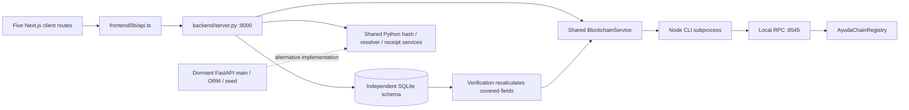

# Evidence, coverage and journeys

2026-10-08, Asia/Manila. Read with [product review](product-review.md), [blueprint](redesign-blueprint.md), [roadmap](validation-and-roadmap.md) and [dated primary-source register](primary-source-research.md). Evidence labels R/S/T/D/X/I/A/P and finding severity are defined in product-review.md. All named people and receipts used here are synthetic. No real cash changed hands. This was expert role-play, not participant research.

## Preservation and isolation

Initial HEAD `6d92882dcbc4496645b4379561f457d1504aed53`, branch `main-2`. Before operation, the working tree already contained README/manifest edits, staged document moves, and untracked AGENTS/CLAUDE/product/ADR context. [initial-state.json](initial-state.json) records status and the SHA-256/size of each of the 73 source files. The new review directory was already visible in the status snapshot because the setup harness was created there; it is this investigation's addition. No existing review was overwritten, no branch was switched, and no commit, push, stash or GitHub write occurred.

All installs, compilation, deployment, database seeding, resets, fixture tampering and mutating API/browser requests ran against a disposable source snapshot at `C:\Users\Yushin\AppData\Local\Temp\ayudachain-investigation-ba4heaqr`. Original databases and `.env` were not used; original manifests/build trees were not mutated or used for runtime startup. Passive ABI/dependency comparisons did read existing artifacts. Environment overrides removed private/RPC/database settings and supplied local RPC. Contract deployment overwrites both tracked manifests; server import rewrites a sample SVG; seeding/reset modifies the database. These producers were inspected first and isolated. No secret values or Hardhat key lists were copied into evidence.

Services were started only after checking the intended ports. Owned PIDs and paths were tracked in the snapshot; failures were induced by stopping those processes, not by broad port-kill scripts. `start_ayudachain.sh` was read but not executed: it depends on Linux `/proc`/`pkill` and broadly kills services. Cleanup and the final per-file preservation comparison are recorded in [completion audit](completion-audit.json).

## Repository coverage

The exact per-file table follows below in the generated **Coverage table** section. Initial inventory was made with `rg --files --hidden` and exclusions, then copied by relative path. Root read all of `backend/server.py`, root manifests/instructions and requirements; an independent track fully inspected 49 frontend/docs/community/config files; another fully inspected 22 backend/contract/shared files. Two concurrently added finance drafts were discovered and fully read during final inventory, bringing coverage to75 files (73 initial +2 concurrent). Whole JSON lockfiles and generated ABIs were parsed/inventoried; all five raster assets were visually inspected. All text first-party modules were read in full; early truncated aggregate reads were followed by bounded reads. Coverage is inspectable in [A notes](design-and-docs-notes.md#exact-source-and-asset-coverage) and [backend/contract notes](backend-contract-notes.md#complete-assigned-coverage), rather than inferred from search hits.

Excluded from exhaustive first-party review: installed dependencies, `.git` object contents, `.next`, compiler artifacts/cache, Python caches, ignored databases, local receipt outputs and secret-bearing `.env` files. Lock manifests and first-party producers were included. Compiled ABI was additionally compared to deployment metadata. Final inventory found `docs/product/drafts/finance-officer-responsibilities.md` and `finance-officer-user-flow.md`, created around02:16 Manila after the initial copy. They were preserved, read and separately hashed in [additional-context-state.json](additional-context-state.json). They were not copied into the runtime snapshot and do not change attribution of observed code. Both say scratch/planned rather than specification. Their Finance Officer/document-ledger direction is integrated into the critique/alternatives; institutional/legal claims remain draft claims pending primary/owner validation. Review artifacts are separately audited.

Missing required context: `docs/product/prd.md`, `docs/system/dfd.md`, `docs/system/erd.md`; ADR contains no decision records. In response to the context questions, the maintainer clarified: hackathon only; intended government body DSWD for disaster-relief funds; no intended pilot operator or existing authority; finance-first drafts are an alternative under consideration. This is user-supplied product context, not evidence of DSWD adoption. Current sitemap/user-flow describe implementation, not authoritative program policy. Proposal assumptions are explicitly labelled; missing requirements were not reconstructed as institutional fact. Future-pilot gap severity is distinguished from immediate hackathon credibility defects.

## Execution path and truth map

**Active:** root `package.json:14`, CONTRIBUTING startup, process argv and successful network interactions establish `backend/server.py`. Its `app.services`/`app.ai` imports are active shared code. **Dormant:** FastAPI routes, ORM database/models/schemas and `seed_demo.py` were inspected but not served or integration-tested. Their separate defects appear only in backend-contract-notes.md; they are not counted as active HTTP observations.

| UI/job | Request | Live validation/mutation | Audit/chain | User outcome |
|---|---|---|---|---|
| Dashboard/batch | GET dashboard/batch | First batch selected; SQLite aggregates | Status checks RPC, rewritten on failure; timeline reads events | Public funding/connected claims, incomplete failure distinction |
| Register | POST beneficiaries | Fuzzy identity comparison; nonduplicates immediately VERIFIED/APPROVED; no required-name guard | Normal registration has no audit; duplicates log flag; no chain | Appears approved without eligibility decision |
| CSV | POST beneficiaries/upload-csv | All-pairs analysis, no staging or persistence | No decision/roster/audit | Pair suggestions only |
| Review | POST beneficiaries/:id/verify | Arbitrary string; VERIFIED→APPROVED, otherwise REJECTED; flags remain | Actor-free event always says manually verified/approved | Conflicting review/flag states |
| Payout | POST distributions/confirm | Exists/positive/≤10000; global SELECT count guard; no program/review/budget guard | Hash→blocking chain call→DB insert/event→commit; failure ignored | CONFIRMED even with failed anchor |
| Verify | POST blockchain/verify | DB lookup; recalculates covered payload | CLI chain read; service rewrites failure/absence into match | Green guarantees; client scenarios can override result |
| Delete/reset | DELETE beneficiaries/:id; POST demo/reset | Delete household leaves payouts; reset empties all five tables | Delete event; reset removes audit then seeds fixed IDs against same chain | Unsafe shared administrative surface |

Source of truth is currently split: DB current metadata and status; one static receipt/OCR; chain operator assertions; browser-only role/scenario/network selections. There is no actual DSWD/FACED, bank, camera/OCR, biometric or identity-provider integration. The imported anomaly detector is not called by either server; active amount flagging is hardcoded. The contract performs no cash transfers. `deploy.js:24–43` produces both JSON manifests; runtime CLI reads the shared manifest/compiled ABI, while Python's default address can override deployment discovery. Do not hand-edit either generated file.

## Setup and exact checks

Host: Windows PowerShell; Node 25.4.0, npm 11.7.0, Python 3.14.5; headless installed Chrome 154.0.8037.98 driven by an existing Playwright runtime, with no browser dependency added. Desktop root 1440×1000, independent A 1365×900, mobile 390×844 (root used touch emulation; Assessment A resized a desktop context). Root mobile and resumed desktop timezone Asia/Manila; first desktop context used host default. This is rendered browser interaction, not source-only evaluation. No actual phone, camera, screen reader, field connectivity or human participant was tested.

Commands below ran from the **snapshot**, never the product working tree. Windows used `python`, not root script `python3`.

| Exact operation | Result and evidence | Practical limit |
|---|---|---|
| `npm ci` in `contracts` | Installed 640 packages; 58 reported advisories (19 low/13 moderate/26 high) | Existing lock only; no audit fix or exploit assessment |
| `npm ci` in `frontend` | Installed 47 packages; 4 reported advisories (3 high/1 critical); Next deprecation/security notice | Applicability/patch choice needs review; no dependency change |
| `python backend/test_backend.py` | 8/8 passed; [output](backend-tests-output.txt) | Helper tests, no API/DB/auth/chain-failure tests |
| `npm test` in `contracts` | 9/9 passed; Solidity compiled, EVM paris; [output](contracts-tests-output.txt) | Basic contract behavior; no cross-layer policy/failure/CLI coverage; Hardhat warned Node unsupported |
| `node node_modules/typescript/bin/tsc --noEmit` in `frontend` | Exit 0; [output](typecheck-output.txt) | Types do not establish behavior |
| `npm run build` in `frontend` | Exit 0; all five routes; [output](build-output.txt) | Config skips lint/types at build; independent typecheck above |
| `npm run lint` in `frontend` | Exit 1 after interactive ESLint configuration prompt; [captured result](lint-output.txt) | No configuration selected, no lint completion or product edits |
| `npm run deploy:local` in `contracts` | Local chain 31337; real contract; [output](deploy-output.txt) | Deployments only snapshot; second output is recovery deployment; no public network |

The first check harness printed Unicode through Windows cp1252 after already writing successful underlying logs; that wrapper exited 1. Harness stdout was corrected to UTF-8. Above results refer to underlying commands/logs, not wrapper failure; no passing test was invented. Hardhat test compilation/deployment supplied compiled artifacts; a separate root compile command was unnecessary.

Reproduction startup, after creating a fresh isolated copy and installing locked dependencies: run `node node_modules/hardhat/internal/cli/cli.js node --hostname 127.0.0.1 --port 8545` from contracts; deploy locally; run `python server.py 8000` from backend; build frontend and run `node node_modules/next/dist/bin/next start -p 3000 -H 127.0.0.1` from frontend. Set `POLYGON_RPC_URL=http://127.0.0.1:8545` and clear inherited deployment/key overrides; use only published local development defaults. Server binds 0.0.0.0 despite local use; do not expose this unauthenticated lab. Snapshot scripts and [lab-control.py](lab-control.py) preserve actual invocation/PID/log handling. Inspect their saved target path before reuse. Do not rerun investigation-setup.py into this evidence directory: it is provenance, and would overwrite its initial manifest.

Two fresh local deployments occurred: initial startup, then restart/redeploy to test an empty chain with retained DB. Original tracked manifests remained unchanged. Raw Hardhat startup logs, which contain development private keys, were deliberately not published. [Backend log](backend-runtime-log.txt) contains synthetic requests, and [failure excerpts](runtime-failure-excerpts.txt) preserve the first ID-collision/lock errors transcribed from captured tool output before the harness's original log mode overwrote that segment. Later service logs append.

## Route and role walkthrough ledger

| Route / implemented personas | Desktop and mobile interactions | Task result |
|---|---|---|
| `/` / Citizen, Officer | Funding overview, links/timeline, network dropdown, custom address save/refresh; real chain/backend outage | Can view totals; selected network/address do not configure backend; misleading live chain caption; outage dashboard has explicit retry |
| `/batch/RELIEF-2026-001` / public | Allocations and audit chronology; raw hashes; second batch and missing batch direct navigation | Can inspect recorded assertions; mobile width expands to 522; no operational allocation preparation/closing job |
| `/beneficiaries` / all three | Search/filter; Inspect; citizen registration; Officer reject and Auditor approve; valid/unsupported-header CSV; keyboard/Escape; refresh draft; browser back after payout draft | Registration and decisions mutate; approval/flag/eligibility confusing; CSV analysis not import; draft lost on refresh |
| `/distributions` / Citizen read, Officer/Auditor payout | Household/amount; fixture scanner; normal payout; offline toggle and actual offline; receipt/view verify; dropped response/retry/refresh; ceiling | DB payout recorded with real local anchor when healthy; no usable receipt preview; no offline queue; uncertain outcome recovery inadequate; Auditor can record payouts |
| `/verify` / all | Existing record, recheck, proof disclosure, two demo scenarios; true amount mismatch; variable amount, missing ref, delayed/failed request; chain/backend outage | Some genuine covered-field matches/mismatches; false green for absent/unreachable chain and stale/wrong record; simulated corruption outcomes |
| `/batch/RELIEF-LAB-002`, missing batch, unknown page | Direct URLs desktop; source route coverage | Second batch renders impossible totals; UI navigation remains seeded batch; generic missing/not-found states |

All major interactions were covered across desktop/mobile collectively; every route had both viewport walkthroughs. Mobile payout form/scanner/review were operated, but no separate mobile payment submission was made. No route provides a supervisor or operator workspace, login, disputes or correction. Those jobs were attempted through navigation/search/source/API inventory and are **unsupported**, not silently treated as successful.

| Complete user job | Actual synthetic exercise | Friction/recovery/result |
|---|---|---|
| Discover product/next action | Citizen dashboard→batch→registry→payout→verify; pitch links and mobile scrolling | Public audit narrative competes with recipient own-record/entitlement task; no scoped next action |
| Locate/register household | Search BEN-0007, Inspect; citizen registered Mira Talabina (DFC-2026-8275) | Registry search works; citizen record immediately approved; prior filtered list stays; refresh loses unsubmitted draft |
| Import/resolve masterlist | Upload provided 10-row synthetic CSV, inspect 4 suggested pairs, then incompatible headers | Analysis only; no durable masterlist decision/publication. Invalid headers appear processed, not rejected |
| Decide eligibility | Officer rejected BEN-0007; API recorded its payout; Auditor approved BEN-0023 | No entitlement decision gate. Table flag and review status conflict; approved case still flagged |
| Record payout/receipt | Simulated voucher selects BEN-0004; record ₱5,000 (DIST-7614) while offline pill enabled | Real local tx succeeded; success card absent at end, selection reset to BEN-0001 with an existing recorded claim; receipt preview image 404 |
| Citizen verify own payout | Receipt link to DIST-7614; raw hashes; missing reference and ₱2,000 payout | Genuine match available, but claims physical delivery/₱5,000; wrong/missing reference substitution unsafe |
| Auditor investigate suspicious record | Registry flag→review→batch audit→receipt→both scenarios; real fixture tampering | Flag review lacks evidence ownership; script red is not real data tampering; no case assignment/dispute/correction |
| Recover failed/interrupted payout | Abort browser response after fetched backend201; retry; refresh; offline/reconnect; actual outages | Unknown outcome represented as failure; refresh eventually reveals claim; no queue or reconciliation; backend restart needed after leaked DB lock |
| Work across batches/localities | API created small second batch and allocation, opened direct batch URL | Backend accepts cross-batch payout/overbudget; normal navigation/form hardcodes first batch |
| Correct/dispute | Inspect record with existing claim, attempt to find correction/dispute; anonymous delete and demo reset isolated | No correction/appeal; deletion or reset are inadequate substitutes; orphan/history/proof issues reproduced |

No click counts, task-duration averages, success-rate study, user quotations or performance measurements were manufactured. The injected 2.5-second delay is a controlled failure scenario, not observed network latency.

## Reproduction protocols

Expected behavior below expresses repository integrity invariants or a minimally truthful response. Where program policy is unknown, the expectation is an explicit governed decision, not a guessed entitlement rule. Use a fresh disposable copy; baseline/tamper/reverse/outage/delete probes have ordering dependencies and **must never target a real database**.

### E01 — Failure/absence falsely matches (F01)

**Role/start:** recipient or anonymous API; seed DB has a payout, running local contract. **Steps:** verify DIST-0001; stop owned chain; GET dashboard; POST verify; record fresh synthetic BEN-9906 as DIST-OUTAGE; restart fresh node/redeploy without clearing DB; read contract `distributions(bytes32('DIST-0001'))` independently; verify again. **Expected:** unavailable while RPC down; absent on empty chain; failed/pending anchor with no fabricated tx. **Actual:** dashboard CONNECTED/Amoy Standby; saved payout201; API true with echoed hash; green UI. Empty chain getter returned zero values/exists false; retained DB verify still true. **Evidence:** [outage JSON](api-probes-outage.json), [recovery/reset JSON](recovery-and-reset.json), [screenshot](screenshots/33-chain-down-false-authentic.png), [restarted chain screenshot](screenshots/34-chain-restart-retained-db.png); source blockchain.py:61–120, server.py:697–761. High confidence R/S.

### E02 — A verdict does not belong to the selected record (F01/F10)

**Role/start:** Officer, `/verify`, existing green result. **Steps:** select another receipt with its request delayed 2,500 ms; separately abort the next verify request (independent A tab); open `?distribution_id=DIST-MISSING`. **Expected:** pending/error bound to exact requested ID, no old success, missing ID stays missing. **Actual:** new household/amount with old green/hash during delay; old green remains after failed new request; missing lookup404 alerts then selects latest unrelated DIST-RACE-1. **Evidence:** O07/O14 [observations](browser-observations.json), [delay screenshot](screenshots/30-delayed-verification-stale-result.png), [A failure screenshot](design-a-stale-verification-desktop.png), [missing reference](screenshots/18-missing-reference-substitution.png); verify/page.tsx:13–69. High R/S.

### E03 — Hash coverage and physical-delivery claim diverge (F02)

**Role/start:** auditor, healthy original chain/seed. **Steps:** in isolated DB change only BEN-0001 household name; verify; restore. Replace sample SVG bytes; verify; restore. Change DIST-0001 amount5000→2000; verify; restore. Also verify recorded DIST-REJECTED with API-reported matching status amount2000. **Expected:** precisely describe covered/not-covered fields; mismatch for changed covered amount; display actual approved/recorded values without cash-delivery proof. **Actual:** name and file changes remained true; amount change mismatched then restored true; recorded2000 payout green screen claimed exact5000, seal5000. **Evidence:** [tamper JSON](api-probes-tamper.json), O06, [2000 screen](screenshots/17-nonstandard-payout-verification.png); hasher.py:25–49, verify:231–315, static OCR. High R/S; no real corruption allegation.

### E04 — Demonstration/evidence capture is not the claimed integration (F02/F07)

**Role/start:** Officer, `/distributions`, synthetic unpaid BEN-0004; local stack healthy. **Steps:** open scanner and select fixture voucher; payout; open receipt; verify; run scenarios A/B. **Expected:** labelled simulation separated from genuine evidence; correct per-payout acknowledgement; scenarios visibly simulated in result/API. **Actual:** scanner has no camera, seeded and UI-created payouts reuse sample OCR/SVG; image URL goes to frontend `/receipts/...`404, naturalWidth0; scenario API returned true but client showed false/invented hashes and corruption. **Evidence:** O02–04; [preview](screenshots/13-receipt-preview.png), [scenario](screenshots/15-name-swap-simulation.png), [network](browser-network.json); distributions modal, verify:45–69, receipt_generator. High R/S. No live OCR/biometric test was possible because none exists.

### E05 — Authorization, registration and review boundaries (F03/F05/F06)

**Role/start:** no credentials; registry contains synthetic households. **Steps:** GET all beneficiaries/single ID; POST blank household with DFC-2026-9902; normal registration and compare audit count; submit MADE_UP review status; reject BEN-0007 in Officer UI, inspect audit, then confirm its payout; switch to Auditor payout screen. **Expected:** bounded authorized data/actions; validated input; human approval; audit accurately states action; rejected entitlement cannot be silently paid. **Actual:** public contact/review data and CORS*; blank auto-approved; no normal-registration event; arbitrary status200; rejection described as approved; rejected/flagged payouts recorded; Auditor button available. **Evidence:** [baseline JSON](api-probes-baseline.json), O15; registry/review screenshots; server:415–490,559–717, roleContext. High R/S. Legal disclosure policy remains a controller/DPO decision, not a certified violation.

### E06 — Parallel claims / sequential guard (F04)

**Role/start:** anonymous caller; BEN-9904 newly registered, no prior claim; healthy node. **Steps:** concurrently POST DISTINCT distribution IDs DIST-RACE-1 and -2 for same beneficiary; query DB/API and chain separately. Also retry a previously recorded payout sequentially. **Expected:** one durable payable attempt per entitlement, with repeat returning its existing status. **Actual:** both parallel201, two DB rows; independent chain only RACE-1 existed. Sequential repeat400 is a useful but insufficient guard. **Evidence:** baseline `concurrent-*` rows, [independent chain JSON](direct-chain-evidence.json); server:677–717. High R/S. This demonstrates two recorded claims, not two real cash payments or two confirmed chain writes.

### E07 — Unknown result, divergent write and false offline queue (F04/F07)

**Role/start:** Officer; unpaid BEN-9908 after recovering backend lock. **Steps:** intercept payout with Playwright route.fetch (server commits201), then abort browser response; retry; refresh. Separately preload unpaid form, enable Offline Mode, set browser truly offline, submit, reconnect and refresh. Reverse-order probe inserts a fixture DIST-DB-ONLY locally, submits same ID for BEN-9905 (unpaid), compares DB and chain. **Expected:** recover same attempt/status, durable queue if claimed, explicit two-system reconciliation. **Actual:** failed-fetch alert despite committed DIST-0125; retry generic failure, refresh reveals claimed. Offline no durable storage/worker/queue and no later record. Chain asserted BEN-9905 before DB UNIQUE error left old BEN-0001 fixture; leaked connection then caused database locked. **Evidence:** O10–12, [lost response](screenshots/24-response-lost-after-commit.png), [retry](screenshots/25-retry-after-unknown-result.png), [offline](screenshots/27-actual-browser-offline.png), [reverse probe](api-probes-reverse.json), direct-chain-evidence, runtime-failure-excerpts. High R/S. First dropped-response harness attempt failed because of that lock and reset Node REPL; it is explicitly labelled harness recovery, not counted as successful evidence. A fresh later attempt produced the stated201/abort.

### E08 — Review/import does not produce an approved roster (F05/F08)

**Role/start:** Citizen CSV control / Officer review, seeded10-row CSV. **Steps:** analyze file; upload two rows with `person,locality`; inspect counts and registry; reject/approve flagged records and revisit filters. **Expected:** analysis-only stated or persisted staged import; required header errors; durable human case resolution separate from raw similarity provenance. **Actual:**10 processed/4pairs but no rows imported; incompatible2 rows processed/0pairs with no mapping/error; single-record review exposes only a matched BEN ID/generic reasoning, without linked comparison details; rejected row stays FLAGGED, approved BEN-0023 still98% flag. **Evidence:** [CSV](screenshots/08-csv-analysis.png), [bad headers](screenshots/09-csv-invalid-headers.png), mobile auditor approved screenshot; entity_resolution:195–260, server:599–641. High R/S. Percentages are heuristics, not measured probabilities; legitimate same-name/repeated aid cases require field validation.

### E09 — Deletion destroys operational linkage (F03/F06)

**Role/start:** anonymous API, retained BEN-0001 with a recorded claim; isolated DB. **Steps:** DELETE beneficiary; count its payouts; verify/read UI. **Expected:** authorization and correction/withdrawal policy retaining accountable history, no substituted identity. **Actual:**200 delete; payout remains orphaned; verify true; UI substitutes Danilo fallback. **Evidence:** [delete JSON](api-probes-delete.json), [orphan screen](screenshots/35-deleted-household-orphan-verification.png); server:816–840, verify fallback. High R/S. Chain was freshly redeployed at this point, so this match is also fail-open absence, not a surviving original chain proof.

### E10 — Demo reset and chain recovery (F01/F03/F06)

**Role/start:** Public Citizen, seeded DB/chain after first reset. **Steps:** record audit IDs/tx; click Reset Demo and accept; await HTTP200; collect new audit IDs/tx; lookup claimed new tx directly. **Expected:** demo reset isolated from operation; seed detects existing immutable IDs and reports real proof/reference or labelled simulation. **Actual:** before IDs30–41 replaced by42–53; same contract rejects duplicate writes; new DIST-0001 tx receipt is null. Citizen could perform reset. **Evidence:** recovery-and-reset `citizen-repeat-reset-same-chain`, [screen](screenshots/37-citizen-repeat-reset-fabricated-transactions.png); server:777–787, seed:134–244. High R/S. First reset artifact mistakenly sampled while seeding and requested wrong audit URL; its role/key mistake is labelled. Only second awaited reset supports the final claim. Audit deletion is permitted solely within repository demo reset, but this route lacks an operational/demo boundary.

### E11 — Program/budget coupling (F05/F09)

**Role/start:** anonymous API; BEN-9901 registered to seed batch. **Steps:** release RELIEF-LAB-002 amount10; allocation1000000; distribute5000 against second batch; display direct batch URL; confirm against nonexistent RELIEF-NOT-ONCHAIN; negative release. **Expected:** explicit valid program/approved entitlement/resource policy and failed-chain state. **Actual:** all201; second batch visibly with recorded allocations/distributions exceeding its recorded release; absent batch distribution saved with fabricated tx and green verify; negative release saved. **Evidence:** baseline labels `tiny-program-*`, `over-allocation`, `cross-batch-*`, `unknown-batch-*`, `negative-*`; [second batch](screenshots/19-second-batch-overallocated.png); server:499–548,648–717, contract:142–172. High R/S. Exact repeated-aid rule and funding authority remain unresolved.

### E12 — Empty/error/mobile/keyboard states (F10)

**Role/start:** synthetic registry/payout data. **Steps:** open registration/review/scanner, Tab and Escape; inspect named inputs/dialog roles; all routes at390×844; stop owned backend and visit all routes; inject [] for list APIs only. **Expected:** modal focus/labels, readable layout, errors distinct from empty/not-found, no stale success without data. **Actual:** zero dialog roles/associated labels, focus stays launcher and tabs behind overlay, Escape does not close; batch measured522px; outage registry empty, batch not-found, payout connected caption; list-only [] fixture leaves enabled no-household payout and verify defaults DIST-0001. **Evidence:** O16/O18/mobile widths, [keyboard screen](screenshots/31-keyboard-registration-modal.png), backend-down/empty screenshots, [detector](impeccable-browser-detector.json), [mobile metrics](impeccable-browser-mobile.json), [modal metrics](impeccable-browser-modals.json). High R/S for samples. O19 separately chose BEN-0004/amount2000, navigated to Verify Integrity and used browser Back: unsubmitted draft reset to BEN-0001/5000. [Back-navigation screenshot](screenshots/38-back-navigation-payout-draft.png). This was a read-only form exercise with no payout submission; chain remained stopped. Empty-list injection is not a fully empty database test; server auto-seeds on startup. No full accessibility conformance claim.

### E13 — Invalid input and retained useful guards

**Role/start:** anonymous API / Officer form. **Steps:** zero and10001 amount, missing beneficiary, malformed JSON, nonnumeric amount, ordinary duplicate retry. **Actual:** positive/ceiling/existence and sequential duplicate checks returned400/404 as applicable; form disabled invalid amount; malformed JSON/nonnumeric amount closed connection rather than structured4xx. Backend health remained available. **Evidence:** baseline, O13, screenshot29; server JSON/float conversions. High R/S. The10000 cap is current behavior, not established statutory policy.

### E14 — Identifier and monetary encoding boundaries (F11)

**Evidence type:** S plus executed in-memory probes by the backend/contract track, high confidence; no long-ID live payment was submitted. **Boundary/role:** operator/API caller, CLI `toBytes32` and shared hasher; active confirmation accepts supplied IDs/amounts. **Reproduce:** apply the CLI's `ethers.encodeBytes32String(str.slice(0,31))` expression to `'A'.repeat(31)+'1'` and the same prefix+'2'; compare encodings. Try31 U+00E9 characters. Hash identical metadata/OCR with amount1.001 and1.002, then compare CLI amount conversion. **Expected proposed boundary:** no silent ID collision, validated byte limit, explicit approved monetary precision with retained v1 lookup compatibility. **Actual pure probes/source:** suffix-distinct IDs collide; multibyte31-character string fails encoding; both amounts hash as1.00 although CLI `parseEther` represents their different submitted values. **Refs:** blockchain_client.js:34–41,76/94/111; hasher.py:41; [complete probes/notes](backend-contract-notes.md#canonical-hash-trace-and-limits). Existing API/chain outcomes for these specific inputs remain unverified. Changes require compatibility decisions, not casual fixes.

### E15 — Concurrent finance drafts: planned-state review

**Severity:** proposed P1 pilot gate if adopted, not an implemented defect. **Evidence:** D/S for draft content; I for operational risks, medium confidence until owner/field validation. **Role/starting state:** proposed Finance Officer, no implemented route; both files explicitly scratch/planned. **Steps:** read responsibilities:9,28–44 against user-flow:48,66–87,93–102,119–124,139–142. **Actual documented proposal:** deferred sign-in/approval, file-hash duplicate rejection, optional transfer document and received/remaining totals, file-only integrity recheck with three outcomes, reversing/replacement entries, later liquidation and exports. **Expected proposed pilot:** accountable humans, distinct authority/settled-cash states, logical release identity and human duplicate review, file-plus-entry version provenance, full failure states, consistent correction arithmetic, approved evidence/export and private actor identity. **Consequence/root cause:** draft simplifications could double-count releases, overstate cash/proof, obstruct legitimate reuse/correction or fail accountability; a ledger-only demonstration is not automatically an operational finance job. **Action/verification:** confirm actual scope and current office rules; test same event/different scan, paired documents, reused attachment, changed structured amount with unchanged file, reversal arithmetic, pending/absent anchors and authorized review/export. None was run as a finance UI because it is unimplemented. [Responsibilities](../../product/drafts/finance-officer-responsibilities.md), [flow](../../product/drafts/finance-officer-user-flow.md). These sources' hierarchy, bond/time-limit and liquidation assertions are unvalidated draft claims, not adopted requirements or COA acceptance.

## Documentation contradictions

| Claim (D) | Established disposition and refs |
|---|---|
| Offline queuing/reconnection sync (README/guides) | UI toggle only; actual browser offline failed/no queue (E07); no service worker/IndexedDB |
| OCR/QR/biometric-backed receipt | Fixture scanner, decorative sample QR and constant OCR (E04); no such integrations |
| Every modified name/receipt is caught; cash reached family | Hash excludes independently stored name/file bytes; physical receipt not established (E03); architecture:77, verify copy |
| Fraud simulations change database / public chain | Client override only (E04); actual name-only DB edit remained matching |
| DPA-safe because PII off-chain | Public APIs expose private fields; lawful/proportionate audience policy unresolved (E05), NPC sources |
| Universal statutory5000 and10000 ceiling | Program amounts variable; no universal basis found; ECT amendment unresolved; primary-source-research |
| AI anomaly/velocity detection | Helpers unused in runtime; no time input in velocity rule; active flag is hardcoded amount (backend notes) |
| Nationwide<$0.001/household; typical30gwei | One local gas receipt; dated mainnet estimate differs; no executed production/fiat cost evidence |
| COA audit universally6–12months (screen also18months) | No substantiating primary data; liquidation/reconciliation/audit/publication differ; no adoption/accepted export evidence |
| Real-world household data / fully implemented national infrastructure | All investigation fixtures synthetic; no adoption established; guides should distinguish fictional cases and prototype |
| Passing checks prove readiness | Existing helper/basic contract tests pass while E01–E12 fail; build skips lint/types (typecheck separately passes) |

The existing sitemap/user-flow are more candid than the pitch. Full precise documentation refs are preserved in A notes; external dispositions cite dates and access limitations in the primary-source register. No existing document was rewritten by this investigation.

## Independent design checks

Assessment A finished before root read Assessment B detector findings. B's CLI returned9 warnings;6 were structural false positives (conditional colors and intentional scanner corner brackets). Remaining3 were weak aesthetic hints, not contrast evidence. Clean pre-overlay browser scan recorded187 rule occurrences across178 element groups, dominated by repeated small text. Concrete sampled text ratios: dashboard timestamp2.6:1, allocation summary3.7:1, receipt metadata2.5:1. These are detector-computed style ratios, not full WCAG certification. No unrequested cosmetic rewrite follows from those counts.

B used its own headless contexts and a temporary snapshot-only helper. DOM/script preflight and detector injection succeeded; own helper/browser stopped. A/B screenshots and raw results are retained. Neither track substituted automated counts for observed task/credibility problems. Root visually inspected representative own dashboard, mobile batch, outage-verification and broken receipt screenshots, in addition to interactive DOM/network observations; A visually inspected all16 of its screenshots.

## Untested and unsupported areas

- No real pilot users, institutional buyer/owner interview, language comprehension test, full current policy pack, legally reviewed public disclosure or COA acceptance. Hackathon-only/DSWD-intended context was supplied; no pilot/operator/authority exists and no institutional requirements were invented.
- No production network deployment/payment, real identity/card/biometric integration, actual receipt capture, cash delivery or bank-provider reconciliation. Such features do not exist in current routes.
- No benchmark of throughput/load, nationwide costs, million-row import, prolonged degraded connection, disk-full/backup restore, signer-compromise or actual device sync conflicts. Scale analysis is mechanism-based with labelled proposed scenarios.
- No full empty-database operational mode (automatic seed), full screen-reader/security penetration audit, physical phone/camera test, browser history matrix or exhaustion of all possible input permutations. Refresh, browser back, direct navigation, real offline, injected delay, lost response and actual service outages were exercised; unsupported offline multi-device conflicts are not described as tested.
- Transaction rejection was exercised through missing batch and duplicate reseed; unauthorized live wallet rejection and every Solidity edge condition were source/test reviewed, not additionally transacted. Contract absence was independently read after redeploy.
- Dormant FastAPI was fully inspected, not run. Its optional dependencies were not installed. Linux startup/Docker-like deployment or public network paths were not exercised.

These limitations do not weaken the directly reproduced integrity blockers. They limit claims about demand, legal/operational readiness and scale. Additional evidence needed for a real pilot is precisely identified in the roadmap.

## Coverage table

| First-party file | Inspection | Exercised / unverified boundary | Track |
|---|---|---|---|
| `.env.example` | Full source/text review | Read only; configuration/context reviewed | Design/docs track |
| `.github/ISSUE_TEMPLATE/bug_report.md` | Full source/text review | Read only; remote CI/GitHub actions not run | Design/docs track |
| `.github/ISSUE_TEMPLATE/feature_request.md` | Full source/text review | Read only; remote CI/GitHub actions not run | Design/docs track |
| `.github/PULL_REQUEST_TEMPLATE.md` | Full source/text review | Read only; remote CI/GitHub actions not run | Design/docs track |
| `.github/workflows/ci.yml` | Full source/text review | Read only; remote CI/GitHub actions not run | Design/docs track |
| `.gitignore` | Full source/text review | Read only; configuration/context reviewed | Design/docs track |
| `AGENTS.md` | Full source/text review | Read only; configuration/context reviewed | Design/docs track |
| `CLAUDE.md` | Full source/text review | Read only; configuration/context reviewed | Design/docs track |
| `CODE_OF_CONDUCT.md` | Full source/text review | Read only; configuration/context reviewed | Design/docs track |
| `CONTRIBUTING.md` | Full source/text review | Read only; configuration/context reviewed | Design/docs track |
| `LICENSE` | Full source/text review | Read only; configuration/context reviewed | Design/docs track |
| `README.md` | Full source/text review | Read only; configuration/context reviewed | Design/docs track |
| `SECURITY.md` | Full source/text review | Read only; configuration/context reviewed | Design/docs track |
| `backend/app/ai/anomaly_detection.py` | Full source/text review | Pure tests; imported but runtime analyzer unused | Backend/contract track |
| `backend/app/ai/entity_resolution.py` | Full source/text review | Exercised in isolated live stack | Backend/contract track |
| `backend/app/blockchain/AyudaChainRegistry.json` | Full generated metadata / producer review | Local deploy regenerated snapshot copies | Backend/contract track |
| `backend/app/data/receipts/sample_relief_receipt.svg` | Full source/text review | Full markup; producer/use boundary examined | Backend/contract track |
| `backend/app/data/seed_beneficiaries.csv` | Full source/text review | Read only; configuration/context reviewed | Backend/contract track |
| `backend/app/database.py` | Full source/text review | Dormant; not served | Backend/contract track |
| `backend/app/main.py` | Full source/text review | Dormant; not served | Backend/contract track |
| `backend/app/models/entities.py` | Full source/text review | Dormant; not served | Backend/contract track |
| `backend/app/schemas/schemas.py` | Full source/text review | Dormant; not served | Backend/contract track |
| `backend/app/seed_demo.py` | Full source/text review | Dormant; not served | Backend/contract track |
| `backend/app/services/blockchain.py` | Full source/text review | Exercised in isolated live stack | Backend/contract track |
| `backend/app/services/hasher.py` | Full source/text review | Exercised in isolated live stack | Backend/contract track |
| `backend/app/services/receipt_generator.py` | Full source/text review | Exercised in isolated live stack | Backend/contract track |
| `backend/requirements.txt` | Full source/text review | Full read; dormant pip deps not installed | Root |
| `backend/server.py` | Full source/text review | Exercised in isolated live stack | Root |
| `backend/test_backend.py` | Full source/text review | Executed: 8/8 | Backend/contract track |
| `contracts/contracts/AyudaChainRegistry.sol` | Full source/text review | Exercised in isolated live stack | Backend/contract track |
| `contracts/hardhat.config.js` | Full source/text review | Local test/deploy/node; no public network | Backend/contract track |
| `contracts/package-lock.json` | Full generated metadata / producer review | npm ci in isolated copy | Backend/contract track |
| `contracts/package.json` | Full source/text review | Scripts inspected; relevant commands executed | Backend/contract track |
| `contracts/scripts/blockchain_client.js` | Full source/text review | Exercised in isolated live stack | Backend/contract track |
| `contracts/scripts/deploy.js` | Full source/text review | Exercised in isolated live stack | Backend/contract track |
| `contracts/test/AyudaChainRegistry.test.js` | Full source/text review | Executed: 9/9 | Backend/contract track |
| `docs/adr/.gitkeep` | Full source/text review | Claims checked; no edits | Design/docs track |
| `docs/guides/demo-script.md` | Full source/text review | Claims checked; no edits | Design/docs track |
| `docs/guides/user-guide.md` | Full source/text review | Claims checked; no edits | Design/docs track |
| `docs/product/sitemap.md` | Full source/text review | Claims checked; no edits | Design/docs track |
| `docs/product/user-flow.md` | Full source/text review | Claims checked; no edits | Design/docs track |
| `docs/system/api-contract.md` | Full source/text review | Claims checked; no edits | Design/docs track |
| `docs/system/architecture.md` | Full source/text review | Claims checked; no edits | Design/docs track |
| `docs/system/blockchain-spec.md` | Full source/text review | Claims checked; no edits | Design/docs track |
| `frontend/app/batch/[id]/page.tsx` | Full source/text review | Rendered desktop/mobile; interactions/failures | Design/docs track |
| `frontend/app/beneficiaries/page.tsx` | Full source/text review | Rendered desktop/mobile; interactions/failures | Design/docs track |
| `frontend/app/distributions/page.tsx` | Full source/text review | Rendered desktop/mobile; interactions/failures | Design/docs track |
| `frontend/app/globals.css` | Full source/text review | Read only; configuration/context reviewed | Design/docs track |
| `frontend/app/layout.tsx` | Full source/text review | Read only; configuration/context reviewed | Design/docs track |
| `frontend/app/page.tsx` | Full source/text review | Rendered desktop/mobile; interactions/failures | Design/docs track |
| `frontend/app/verify/page.tsx` | Full source/text review | Rendered desktop/mobile; interactions/failures | Design/docs track |
| `frontend/components/DemoPitchBar.tsx` | Full source/text review | Live routes / shared interactions | Design/docs track |
| `frontend/components/Navbar.tsx` | Full source/text review | Live routes / shared interactions | Design/docs track |
| `frontend/components/RoleIndicatorBanner.tsx` | Full source/text review | Live routes / shared interactions | Design/docs track |
| `frontend/lib/api.ts` | Full source/text review | Live routes / shared interactions | Design/docs track |
| `frontend/lib/roleContext.tsx` | Full source/text review | Live routes / shared interactions | Design/docs track |
| `frontend/next-env.d.ts` | Full generated metadata / producer review | Build/typecheck in snapshot | Design/docs track |
| `frontend/next.config.mjs` | Full source/text review | Build/typecheck in snapshot | Design/docs track |
| `frontend/package-lock.json` | Full generated metadata / producer review | npm ci in isolated copy | Design/docs track |
| `frontend/package.json` | Full source/text review | Scripts inspected; relevant commands executed | Design/docs track |
| `frontend/postcss.config.mjs` | Full source/text review | Build/typecheck in snapshot | Design/docs track |
| `frontend/public/logo-emblem-transparent.png` | Full visual asset review | Visually inspected; rendered brand assets | Design/docs track |
| `frontend/public/logo-emblem.png` | Full visual asset review | Visually inspected; rendered brand assets | Design/docs track |
| `frontend/public/logo-transparent.png` | Full visual asset review | Visually inspected; rendered brand assets | Design/docs track |
| `frontend/public/logo-trimmed.png` | Full visual asset review | Visually inspected; rendered brand assets | Design/docs track |
| `frontend/public/logo.png` | Full visual asset review | Visually inspected; rendered brand assets | Design/docs track |
| `frontend/public/sample_relief_receipt.svg` | Full source/text review | Full markup; producer/use boundary examined | Design/docs track |
| `frontend/public/seed_beneficiaries.csv` | Full source/text review | Browser CSV analysis fixture | Design/docs track |
| `frontend/tsconfig.json` | Full source/text review | Build/typecheck in snapshot | Design/docs track |
| `frontend/types/lucide-react.d.ts` | Full source/text review | Read only; configuration/context reviewed | Design/docs track |
| `package.json` | Full source/text review | Scripts inspected; relevant commands executed | Design/docs track |
| `shared/contracts/AyudaChainRegistry.json` | Full generated metadata / producer review | Local deploy regenerated snapshot copies | Backend/contract track |
| `start_ayudachain.sh` | Full source/text review | Read only; Linux path not executed | Design/docs track |

| `docs/product/drafts/finance-officer-responsibilities.md` | Full source/text review | Concurrent planned/scratch context; no runtime counterpart | Root + independent draft reviews |
| `docs/product/drafts/finance-officer-user-flow.md` | Full source/text review | Concurrent planned/scratch context; no runtime counterpart | Root + independent draft reviews |

Machine-readable counterpart: [coverage-ledger.json](coverage-ledger.json). All75 files covered (73 initial +2 concurrent); runtime participation is distinguished from passive inspection.
