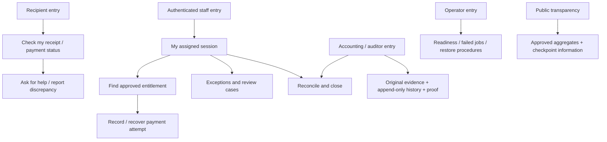

# Proposed product blueprint

**Proposal, not implemented behavior or authorization to implement.** 2026-10-08. This follows [findings F01–F11](product-review.md#prioritized-findings) and [reproductions E01–E15](evidence-and-journeys.md#reproduction-protocols). Maintainer context: hackathon only; intended body DSWD for disaster-relief funds; no pilot operator/authority; finance ledger is an alternative under consideration. This blueprint separates a coherent synthetic demonstration from a possible later institutional product. Actual owner, program/policy and workload remain unvalidated. No new schema, dependency, hash encoding or contract interface has been approved.

## Four directions that solve different jobs

| Direction | Primary job / user | Evidence and human responsibilities | Current capabilities retained / removed / replaced | Adoption, risk and validation |
|---|---|---|---|---|
| **A. Relief program orchestration** | Program authority coordinates registration, assessment, eligibility, funding and delivery across localities | Official assessments/approval, authorized payment channels and claimant acknowledgement; institution decides eligibility and grants; per-record chain proofs can witness later consistency | Retain registry/review, allocation records and hash anchoring; replace fixed5000/one-batch model with real program policy and full authority; remove scripted outcomes | Large policy/integration burden, competing systems, interagency ownership and major privacy exposure. Validate an unmet coordination need and authority before undertaking it. Current app lacks too much of this operating model for a defensible first pilot |
| **B. Recipient receipt and complaint service** | Recipient checks own approved payment record and reports a discrepancy independently of the cashier | Official payable amount, retained acknowledgement/provider evidence and case handling; independent recipient channel can challenge even a matching anchor; institutions still approve/pay/investigate | Retain scoped verification and plain guidance; replace public registry, payout UI and AI with trusted ingestion and disputes; retain per-receipt public anchor if needed; remove unsupported guilt claims | Smaller operational surface but requires a reliable official feed, safe response owner and access without smartphone. Fails if complaints return to the accused operator or no institution acts. Validate recipient access, safety and response effectiveness |
| **C. Payout and reconciliation workbench — recommended** | Accountable payout supervisor/team completes one approved roster/session and explains every payment/exception | Approved entitlement roster, durable payment attempts, original acknowledgement and payment-channel reconciliation, human closing review, independently retained signed checkpoints; optional periodic public roots | Retain search, human duplicate suggestions, canonical evidence commitments and audit chronology; replace automatic approval/CONFIRMED with explicit decisions/evidence; remove national pitch, client authority, false offline/scanner and per-payout chain dependency | Bounded adoption but risks duplicating existing payroll. Validate accepted closing package, reduced unresolved cases and independent witness value. Smaller blockchain footprint reduces synchronous dependencies/public metadata; it does not solve dishonest original entry |
| **D. Document-backed fund-release ledger — finance-first alternative** | Named finance team records, reviews, corrects and exports release evidence for one office/disaster | Retain original authority/transfer documents and human approval, structured entry version and signature-validation outcome; independent signed export/checkpoint witnesses later consistency, not cash arrival by itself | Retain hash/audit ideas, replace household/payout/AI/public registry with sourced release entries; remove implied received/available balances unsupported by transfer/advance evidence | Directly follows concurrent scratch finance drafts, not confirmed requirements. Smaller scope and blockchain footprint; cannot claim aid delivered or a closed payout. Validate whether the office needs this ledger and can use its export rather than existing finance tools |

**I/A:** C is strongest under the provisional assumption that a single authorized team needs a defensible account of its payouts and exceptions. It completes a whole job the current product stops before: reconciliation and accountable closure. A is weaker until authority and integrations are real. B is potentially valuable but dependent on someone else's trusted records and grievance response; retain its recipient-facing function inside C rather than promise an unsupported standalone watchdog.

The two concurrent [finance drafts](../../product/drafts/finance-officer-user-flow.md) describe a different possible first version; the maintainer confirmed it remains an alternative. If later selected, **D supersedes C for that MVP**; C is not an obligation to build more. D's coherent bounded job is authorized release intake→document/structured-field human review→scoped approval→append-only correction→retained closing/export package. Separate spending authority, transfer evidence and actual cash/advance reconciliation; unsupported dimensions remain unavailable, not zero. Sign-in and accountable approval are required for an operational pilot even though the draft defers them; clearly labelled synthetic personas remain acceptable for a hackathon. No document→no supported entry; duplicate economic release checks require program/issuing authority/reference/version review as well as file hashes. Hash both approved structured evidence and original-file digest under an explicitly approved version; validate a digital signature only when its format/trust chain is actually supported, otherwise report unavailable. No signature, fund arrival or authenticity inference follows from a file hash. D needs its own approved scope and field validation; subsequent sections specify C's full payout target rather than falsely present D's planned features as implemented.

D must preserve human decision-making too: a repeated file hash is a document-reuse signal, not automatic rejection of a financial event. Paired authority/transfer documents support one reviewed economic event rather than two additions to funds. Reversal/replacement entries and approvals have defined arithmetic; originals stay visible but cannot be counted twice. A bank/authorized-channel confirmation supports settled-cash claims; merely uploading a purported transfer notice does not. A signature result is distinct from the signer's financial authority, and validation needs issuer/trust-chain, signed-content and revocation rules. Any on-chain approver identity is an opaque reference, with identifying details private. Payouts plus returns equalling an advance is an internal reconciliation check, not a claim of accepted liquidation. E15 separates these draft risks from runtime evidence.

Signed exports independently retained by an auditor/accounting recipient are the simplest witness to test first. If users require a public commitment, use a session/batch root with retained per-record inclusion proofs, rather than forcing a network transaction into cash handover. Merkle proofs are a technical option, not an established Philippine payout standard; retaining leaves, versions and proof material is essential. [IETF RFC 9162, December 2021, accessed 2026-10-08](https://www.rfc-editor.org/rfc/rfc9162.html)

**Integrity boundary:** a signed-only checkpoint may be described as signed and independently retained; it must never be called chain-verified. In chain mode, a successful verification requires an actual chain-read root/hash and the exact matching record/proof. Chain unreachable, absent record, failed anchoring and mismatch remain distinct. The deployment decision is separate from this investigation; nothing was deployed outside a local node.

## Target thesis, users and boundaries

**Immediate hackathon scope:** one invented program, explicitly simulated approvals/actors/handover, a few synthetic households, one complete recorded-payout→receipt→reconciliation→discrepancy story, and truthful local proof/failure states. Show a real local hash match and a genuine covered-field mismatch; show why a matching hash cannot settle a cash complaint. Demo-only role/reset/pitch controls can remain visibly labelled. No real eligibility, DSWD authorization, identity, bank, biometric or public-chain independence is implied. The later operational design below is a proposal for review, not a current contest delivery obligation.

**P:** “Help an authorized payout team close an approved relief payment session with explainable paid, unpaid and disputed outcomes, while giving recipients a truthful record and a safe way to challenge it.”

**A:** first operating context is one approved program/event, one locality/site, one accountable office, one payment modality and a controlled online session. A direct-cash drill is a useful starting validation scenario, but real ECT rules may favor bank/digital accounts. Choose the institution and channel before implementation; do not assign authority to an LGU solely because the demo says so. Under MC11/2025 as issued, digital accounts are primary and direct cash requires justification; later amendment MC24/2025 is outstanding. [DSWD MC11/2025, signed2025-06-19](https://dswd-file-assets.s3.ap-southeast-1.amazonaws.com/wp-content/uploads/2025/07/MC-No.-11-S-2025.pdf)

Primary user: payout supervisor responsible for closing the session; field cashier/officer executes assigned approved payments. Secondary users: roster reviewer, accounting/audit reviewer, recipient/authorized family representative, support operator and controller/DPO. Buyer and accountable owner are unresolved; obtain a named owner with authority over payment rules, records, support and complaints. A job title alone is insufficient.

MVP includes approved roster intake, human exception resolution, session/payment assignments, durable attempts and original acknowledgement, receipt/status recovery, reconciliation, retained closing package, recipient lookup/complaints and truthful commitment states. It can omit new identity matching entirely if an already approved roster is trustworthy; duplicate suggestions remain optional review assistance.

Non-goals: national eligibility system; automatic fraud findings or denial of aid; proof of physical delivery from hash alone; automated cash transfer; biometric/official-card integration without authorization; unrestricted public household registry; unrestricted cross-institution sharing; full offline multidevice payments; nationwide gas/cost promises; replacing prescribed accounting documents with a hash.

## Information architecture and entry points



The recipient landing page should explain the program, how to find a reference, what status does/does not mean, and how to get help without a phone. Staff land on their assigned session, remaining workload, unknown outcomes and exceptions. Auditors land on closing packages and cases; operators see readiness and recovery. Public aggregates are a separate approved disclosure product, not the staff table with fewer buttons. Bilingual task guidance is retained and tested with actual local users.

## End-to-end workflows and screen responsibilities

1. **Prepare:** authority supplies program/event, grant rule, approved roster and funding/payment-channel reference. Intake screen validates required fields, source/version and counts before publication. An import is a staged draft, not approved aid. Resolve possible duplicate identities in a separate case screen; retain both originals, candidate reasons and the human decision. A reviewer may mark distinct households or one linked identity without deleting evidence. Only authorized approval publishes payable entitlements.
2. **Open session:** supervisor confirms approved roster/version, channel, resources, operators and assignments. Screen shows scope, paid/unpaid/held totals and readiness, including server, witness and receipt availability separately. No field worker edits RPC or grants through display controls. If the institutional policy requires a limit, reserve/validate it atomically. Decide how approved changes after opening are controlled.
3. **Locate claimant:** field screen searches assigned roster or reads an authorized card/reference. Show payable amount and source, representative rules and necessary evidence. Identity confirmation is a human responsibility distinct from roster eligibility. Similarity flags cannot automatically deny or approve. Unapproved/held/foreign-session/already-paid items have an explicit reason and next owner.
4. **Execute:** create a durable attempt with an unambiguous reference and prevent a competing payable claim. For digital payments, reconcile provider outcomes; for direct cash, the authorized SOP decides when handover and acknowledgement occur. Record actual declared handover/acknowledgement, actor/time, amount and original evidence. The app is not proof that money moved. A disputed acknowledgement can coexist with “recorded.”
5. **Confirm/recover:** show a stable attempt reference, receipt access and “recorded / acknowledgement obtained / anchor pending” separately. Lost response returns to the same attempt; no new claim generated. Unknown outcomes direct the officer to check record and supervisor/channel confirmation before another handover. Background anchoring has durable jobs and reconciliation; absent tx data is never invented.
6. **Reconcile:** supervisor/accounting compares approved entitlements, payment-channel statement or cash balance, acknowledgement evidence and unresolved attempts. Explain totals and gaps; do not hide overages with clamped summaries. Human review assigns exceptions, accounts for unclaimed funds and signs a versioned closing package. Independent accounting/audit recipient retains the package/checkpoint; public root is an additional witness if selected.
7. **Recipient verification/dispute:** scoped reference reveals the approved/redacted payment information and evidence statuses. Chain match says covered record matches a committed version, with witness/network/date; cash delivery remains independently evidenced or disputed. Missing/unavailable results have help/retry instructions. “I received less,” “wrong household,” “recorded payment I did not receive,” and “reference not found” create private cases with a responsible institution and reference; smartphone use is optional via staffed/paper route.
8. **Correct:** no editing away an anchored assertion. An authorized human proposes a correction with reason/original evidence; required reviewer approves it; new version supersedes old with linked audit and commitments. Disputes can remain open despite a hash match. The decision and remedy are human actions; record compensation/reversal under institutional rules, not pretend the old cash payment never happened.

## Representative screen concepts

These are annotated wireframes, not implemented routes. Values are invented; DFC-2026-9901 is synthetic.

```text
STAFF — Session: Synthetic Islet / approved program version 3
Approved: 120     Recorded: 86     Unknown: 1     Held: 4
Server available · Witness unavailable · Recording policy: permitted, pending anchor

[Find household / payment reference____________________] [Search]

Lino Bituan · DFC-2026-9901   Assigned entitlement: PHP 5,000
Approved by: [named authorized reviewer] · Source: roster v3
Identity/representative checklist: [confirmed according to approved SOP]

[Open payment attempt]     [Hold and refer to supervisor]
Unknown outcome? [Recover an existing attempt] — do not hand over again blindly
```

Readiness policy is an institutional decision: chain failure need not block approved cash operations if recording is durable and the agreed procedure allows pending anchors. It always prevents a successful chain-verification claim. Offline/unrecorded work has a different stop/fallback procedure.

```text
RECIPIENT — Receipt reference: SYNTHETIC-ATTEMPT-9901
Approved award: PHP 5,000 · Recorded handover: PHP 5,000
Acknowledgement: recorded [accessible original / authorized access]
Delivery dispute: none recorded (this does not establish cash possession)

Evidence check: Anchor not yet available
Recorded at [time] · Responsible office [named] · Last checked [time]
We cannot confirm a blockchain match now. Your payment record is retained.

[Try evidence check again] [Report a problem] [Get help without a phone]
[Technical proof and covered fields]
```

```text
SUPERVISOR — Close session / closing package version 1
Approved resources          [reference and amount]
Paid by confirmed channel   [matched statement / authorized cash balance]
Unpaid / returned funds     [accounted amount]
Unknown attempts            1 → assigned officer / resolution deadline
Missing acknowledgements    2 → required evidence / escalation
Disputes                     1 → private case, no public accusation

Closure: blocked by unresolved required evidence
[Review exceptions] [Export draft package]
After human approval: signed package → independent retainer → optional public root
```

Technical hashes belong in progressive disclosure or a proof export. Status, amount, uncertainty and next action belong in the primary task area. No green/red headline announces guilt or physical delivery from digest equality.

## Domain model and lifecycle

Proposed concepts describe responsibilities; they are not an approved database migration.

| Concept | Responsibility / lifecycle |
|---|---|
| Program/event and policy version | Accountable owner, approved payment rule, modality and scope; draft→approved→active→closed |
| Household/representative identity | Private identifying record; evidence and links distinct from eligibility; changes versioned |
| Roster submission and review case | Source rows, provenance, validation; draft→needs review→human resolved→published/withdrawn |
| Entitlement | Approved amount for household/program/event, policy and approver; proposed→approved/held/rejected→paid/unclaimed/superseded |
| Payout session and assignment | Operator/channel resources; prepared→open→reconciling→closed; amendments require authority |
| Payment attempt | Durable reference/idempotency, actor, channel; prepared→in progress→recorded/failed/unknown; reconciled outcome linked to entitlement |
| Original acknowledgement/evidence version | Captured original, declared amount, provenance/access/retention; never silently replaced |
| Anchor job/checkpoint | submitted→pending→confirmed/failed/unknown; includes real tx/network/version/proof material; must reconcile after ambiguous timeout |
| Reconciliation and closing package | Approved totals, channel evidence, exceptions, human sign-off and independently retained commitment |
| Correction/dispute | Open→assigned→investigating→human decision→remedy/closed; superseding records retain originals |
| Audit event | Append-only named actor/action/reason/affected version, accurate outcome for every state change |

Keep these dimensions separate: identity-review result; program eligibility; attempt outcome; acknowledgement status; reconciliation status; anchor availability; integrity result; dispute status. “Verified” must not be the aggregate label for all of them.

## Permissions and separation of duties

| Responsibility | Allowed action | Boundary |
|---|---|---|
| Registrar | Stage roster / evidence and request review | Cannot approve own entitlement or pay by default |
| Authorized reviewer | Decide identity ambiguity/eligibility with reasons | No automatic algorithm approval; own conflict routed to another reviewer |
| Cashier/field officer | Execute assigned approved attempts, recover status, attach acknowledgement | Cannot change award/roster, resolve own contested payment, reset history or change chain config |
| Supervisor/accounting | Open/reconcile/close session; assign exceptions; approve specified corrections | Closing independently supported by channel/cash records; no silent history rewrite |
| Auditor | Read scoped originals/history/proofs, raise findings | No payout/deletion power simply because Auditor view is chosen |
| Recipient/representative | Scoped record and own dispute/help | No registry enumeration or private notes; alternative access needed |
| Operator | Monitor/recover services, manage approved config/key procedures | Technical administration is not eligibility/payment authority; privileged actions audited |
| Controller/DPO | Approve audience, processing/retention/publication rules | Public disclosure minimized and assessed, not inferred from off-chain storage |

One small office may need delegated combined roles; conflicts, reviewer exceptions and oversight must then be explicit. Do not assume unlimited personnel. Named accountability is the minimum; a persona dropdown remains confined to the synthetic demo.

## Privacy, transparency and witnessing

Default private case records include names, contacts, acknowledgement contents, review notes and disputes. Public view shows approved aggregates and commitment metadata; recipient lookup uses scoped access with enumeration controls, not a list of every household. Exact mechanism, retention, lawful grounds and recovery of a lost reference require controller/DPO decision and user research. NPC disclosure opinions are contextual, not a blanket prohibition or authorization. [RA10173](https://privacy.gov.ph/data-privacy-act-/), [NPC Opinion2020-026](https://privacy.gov.ph/wp-content/uploads/2020/10/Redacted-Advisory-Opinion-No.-2020-026.pdf), accessed2026-10-08.

Only opaque references, approved amount representations and digests belong on-chain. Assess linkage and guessing risks when public IDs/digests can be joined to off-chain records; secret proof material/randomized commitments may be necessary, but any encoding change needs approval. Do not publish names/contact/receipt text as a shortcut to transparent evidence. A session root also cannot establish that every eligible household was included: approved roster/version and reconciliation must address omissions.

Independent witnessing requires somebody outside the writing operator's sole control to retain/check commitments and originals or proof material. Local Hardhat is labelled development and can be reset; it does not supply this independence. Production signing keys, writer authority, revocation and recovery need a named institution and rehearsed custody procedure. [Hardhat network/reference, accessed2026-10-08](https://v2.hardhat.org/hardhat-network/docs/reference), [NIST IR8202, 2018-10-03](https://nvlpubs.nist.gov/nistpubs/ir/2018/NIST.IR.8202.pdf)

## Demo and operations

Separate synthetic data, database, contracts/keys and entry point. Demo has persistent visible “simulated” labels on receipts, API results and scenarios, including negative results; no implied government endorsement. Demo reset operates only on disposable demo history. Real locally anchored synthetic records may say “real local development anchor”; they still cannot say independent public proof or cash delivered.

Remove from operational surfaces: pitch bar/fraud scenario buttons, arbitrary role switching, false Connected/Confirmed fallbacks, client-only RPC/address editors, false offline pill, scanner/biometric/OCR claims without integrations, automatic eligibility, Delete Duplicate as case resolution, public private-data registry, fixed5000 entitlement/accusation copy and national readiness/cost promises. Retain search, task guidance, human review assistance, chronological audit and truthful technical disclosure. Fewer misleading controls are a product improvement.

## Before → after journeys

| Job | Current observed path | Proposed complete path / acceptance |
|---|---|---|
| Officer loses payout response | submit→committed201 lost→failure alert→new-ID retry400→refresh to discover claim | same durable attempt→unknown status→recover existing record/channel outcome→one claim and supervisor handover instruction; E07 cannot create a second payable attempt |
| Auditor sees name fraud scenario | scenario→normal true API→client fake mismatch→corruption accusation | original/updated version and covered fields→real proof check→discrepancy case→human decision; no unverified guilt and no invented proof |
| Recipient inspects a recorded2000 claim | recorded2000 with API-reported match→green “family received5000” | approved amount/source + recorded amount + acknowledgement + scope of proof→report shortfall despite matching hash; display values match evidence |
| Reviewer resolves suspected duplicate | Inspect→approve/reject→flag persists / Delete Duplicate | preserve both identities→case decision/reason→eligible or held entitlement separately→auditable resolved case; false positive does not require deleting a family |
| Supervisor closes operations | funding/allocations→payout list→no closing flow | reconcile roster, paid/unpaid/unknown, channel funds/evidence→assign gaps→sign retained versioned closing package; totals explainable before closure |

## Pilot acceptance and approval-dependent migration

The acceptance gate is in [roadmap](validation-and-roadmap.md#acceptance-gate). Before any real pilot: named owner and approved SOP; truthful proof/error states; server-scoped permissions; human decisions and complete audit; durable exactly-once claim semantics under retries/concurrency; real usable acknowledgements; reconciliation/correction/dispute; privacy and restore/key support procedures. There is no arbitrary readiness score.

Proposed schema concepts (entitlements, attempts, versions, cases, evidence/anchor jobs, actors/sessions) require **explicit schema approval**. A changed hash payload/encoding requires approval, ADR, golden fixtures and Python/CLI/contract compatibility tests. Freeze legacy v1 ID→bytes32 lookup fixtures and define validated/versioned new identifiers: current CLI silently truncates to31 characters and multibyte input can exceed bytes32 capacity. New input must reject invalid/colliding encodings rather than silently truncate. Decide monetary precision explicitly: Python hashes two-decimal formatted amounts while CLI retains submitted precision in its18-decimal ledger scale. Golden boundary fixtures must cover rounding, ID collisions, multibyte input and legacy proof lookup before any switch (E14). Reusing existing `anchorRecord` for checkpoint roots may avoid a contract interface change, but its trust/zero-hash/proof semantics still require review; changing storage/public functions requires separate approval and migration plan. Added libraries, backend consolidation/deletion and any public network deployment also require approval. These artifacts authorize none of them.

Preserve existing v1 anchors and original covered fields as v1 evidence; do not recompute new semantics under old hashes. Keep source record/evidence versions and disclose v1 limitations. Legacy provenance is unproven until independently reconciled: classify actual anchor presence/hash match separately from transaction-reference validity. A fabricated/missing tx reference can coexist with an older genuine matching anchor, as repeat reset demonstrated; it is not by itself evidence of absence. Never upgrade synthetic/simulated data into historical payment truth. Corrections append linked v2 records and commitments; historical payments must be reconciled rather than silently reissued. Establish deployment manifest/network/address consistency and retained old/new verifiers before switching. Real data migration cannot infer eligibility, actual cash delivery or original acknowledgement from demo status. Every state change remains human-governed where required and audited; personal data stays off-chain.
