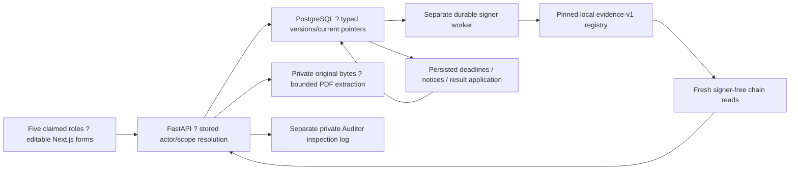

# Implemented local MVP architecture

The authoritative backend is backend/app/main.py. It serves versioned /api/v1 endpoints against the approved PostgreSQL catalogue. backend/server.py and its SQLite file remain an independent legacy runtime. There are no dual writes, automatic API-startup migrations or fixture-driven workflow transitions.

Commands serialize on the Field Office row, re-resolve current claimed identity, compare current revisions, enforce household/staff recusals and commit business facts, typed audit targets, acknowledgements and anchor intentions together. Deferred relationships/typed-audit triggers reject partial facts. Immutable rows and frozen-content triggers preserve history. Paid receipts, entitlement versions and attempts remain locked under database guards.

The worker uses a separate database role and a signer advisory lock. It persists exact raw signed bytes, nonce and candidate before broadcast; actual receipt/getter/event reconciliation supplies observations. The scheduler applies confirmed results once, publishes only the newest still-current list, routes overdue claim windows, delivers labelled simulated notices, expires unused attempts and creates neutral overdue outcomes only after handover.

Business time may be explicitly advanced in the synthetic evaluation. Signing, retries, leases, chain blocks and observations use actual time. No chain RPC occurs inside a business transaction.

The runtime role cannot read private Auditor inspection tables; inspection-role logging must succeed before a private view/file/material is returned. This is a simulated identity boundary, not secure authorization or operational privacy. Claimed actor selection is impersonable.

Originals, private envelopes/nonces, PIN/code verifiers, replay HMAC configuration and raw signed transactions stay off-chain. Public evidence-v1 data contains opaque references, content hashes, kind/context/lineage, timestamps and signed funding amounts only. Household payout amounts remain in private handover proofs. Original contract storage/functions and receipt hash coverage remain unchanged.

See [ERD](erd.md), [API](api-contract.md), [blockchain](blockchain-spec.md), [local operation](../guides/local-mvp.md) and [validation](../implementation/validation.md). Prior diagrams/specification are archived under ../legacy-documentation; they describe the retained legacy implementation.
