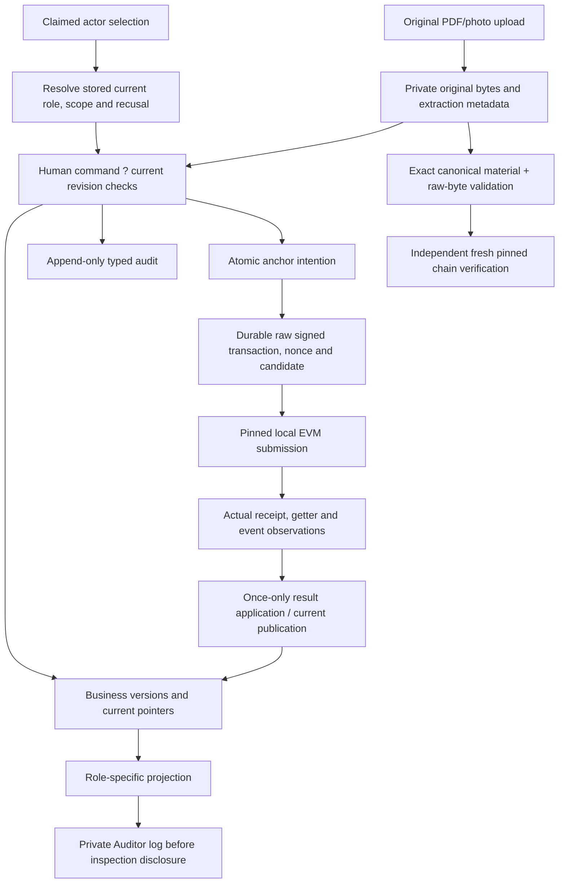

# Implemented MVP data flow

The store definitions are the approved [ERD](erd.md); this is a flow view, not an alternative schema.

The PIN/code path stores salts and verifiers, failure counters and consumed/expired states, never raw secrets in audit, notices or envelopes. The opening response reveals a code once; replay contains handles only. Handover fixes amount and consumes entitlement independently of anchor completion.

Scheduler deadlines derive from persisted records and the labelled business clock. Chain/retry/lease time remains actual. Private latest-answer pointers and grievance/challenge histories do not alter cash-facing fields/revisions. Separate inspection tables are not queryable through the Field Office business trail.

Backup exports a coherent PostgreSQL snapshot, exact originals, hashed manifests, replay HMAC configuration and a surviving-chain checkpoint. Restore verifies checksums and the pinned chain before serving a new database. Unknown post-backup chain records and lost deployments are refused. Explicit reset deploys a new local registry and retires old history; it never deletes originals or discards an uncertain nonce.

No real external identity/SMS/authentication service is connected. The legacy SQLite data flow is separate and is archived under ../legacy-documentation.
