# AyudaChain MVP — approved relational model

Date: 2026-10-10. **Status: schema, PostgreSQL/FastAPI backend, local migrations and separate protocol/registry approved by the maintainer; implemented for local synthetic evaluation.** See [validation](../implementation/validation.md). Implements the target in the [authoritative PRD](../product/prd.md). The [implementation plan](../product-ideation/plans/2026-10-10-mvp-implementation-plan.md) consumes this model and must not define a competing schema. Historical [process](../product-ideation/process.md) S1–S13 and [pivot DFD](../product-ideation/dfd.md) supply logical stores, not one table per store. Existing SQLite tables are legacy, not this ERD.

## Design conventions and scope

**Engine:** PostgreSQL, for transaction/locking/constraint behavior. The tables below are implemented by `backend/app/models/mvp.py` and the explicit versioned migration catalogue. `id` means random UUID primary key unless a composite PK is specified. `ref` means UUID FK to the named table; `?` means nullable, all other fields NOT NULL. Version rows have `created_at timestamptz`, `created_by → actors`, `identity_assurance='claimed_unverified'` for human actions, and frozen actor name/position-at-action where evidentiary. Internal system actors cannot be selected. Timestamps are UTC; session `date` is a Manila civil date. Business effective times and actual write times are separate when a labelled evaluation clock is advanced.

`text`, `boolean`, `integer`, `bigint`, `date`, `timestamptz`, `bytea`, `jsonb` have their ordinary SQL meanings. States/actions/roles are constrained text enums defined here and in the PRD, not arbitrary strings. JSON is limited to derived extraction, check details, calculation explanation and frozen protocol bytes/metadata; it does not replace members, session membership, input rules, FK links or fund correction structure.

Unless explicitly overridden, private `*_id` fields are UUID FKs; names, positions, addresses, phone/email, references, reasons and algorithm/adapter labels are text. `*_at` and deadline/window/lock times are timestamptz; session/issued/birth dates are date. Revisions, ordinals, durations, counters, attempt numbers, scores and status codes are integer with nonnegative/positive bounds as appropriate. Optional fields carry `?`. Receipt/read/extraction/calculation/authorization metadata uses jsonb; salts and secret digests use bytea with algorithm-specific length checks. Public handles and SHA-256 hashes use the explicit 32-byte constraints below.

All PHP amounts are **integer centavos**, positive for wage/fixed/computed amounts, signed for ledger deltas/differences. Use BIGINT with maximum absolute stored value `9,000,000,000,000,000,000`; compute intermediates using exact integers and reject overflow. Aggregate totals use exact NUMERIC, never float/downcast. JSON money is canonical decimal **string**, not a JSON number; zero means a real zero, never missing entitlement input. Counts/revisions are bounded JSON integers. File SHA-256 and chain hash fields are BYTEA with length 32; API renders lowercase `0x` hex. RPC chain ID is NUMERIC(78,0); addresses are 20 bytes. DFC labels are synthetic off-chain display identifiers, never chain IDs.

Each root has `run_id → evaluation_runs` and `office_id → field_offices`, either directly or through its immutable parent; scoped child FKs use matching `(run_id, office_id, parent_id)` alternate keys. Tables omit repeated scope columns below for readability; they are required where needed to enforce composite FKs. A cross-run/office/disaster/household pointer is never valid because an ID looks plausible. One office is seeded; multiple disasters/barangays and actors remain distinct.

Notation: **I** = insert-only facts/history; **P** = mutable current projection, updated only with events; **M** = immutable content plus explicitly named projection columns; **R** = seeded reference. All parent↔current-version FKs are deferred to transaction end and composite-key constrained to their parent. No ON DELETE CASCADE for business/evidence/history. UPDATE/DELETE of I rows is denied to ordinary runtime roles and guarded; privileged administrators remain able to bypass local controls. Evaluation reset is an explicit operator action, not a business undo.

Every linear version/history chain has a same-parent predecessor FK, unique nonnull predecessor and one initial row per parent through a partial unique constraint. Branching response threads use `parent_response_id` instead. For nullable composite relationships, retain a separate mandatory parent/version FK: SQL's treatment of NULL must not allow an unrelated version to bypass the relationship check.

## ER diagram

The diagram shows the principal cardinalities and typed evidence/proof boundaries. Column catalogues below define all keys, supporting tables and constraints; a line is not sufficient to enforce a business rule. Singular role labels denote accounts/actors, not blockchain validators.

```mermaid
erDiagram
    field_offices ||--o{ barangays : contains
    field_offices ||--o{ disasters : covers
    evaluation_runs ||--o{ actors : namespaces
    actors ||--|{ actor_versions : history
    actors ||--o{ nominations : candidate
    barangays ||--o{ nominations : nominates
    households ||--|{ household_versions : facts
    households ||--|{ household_members : identity
    household_versions ||--|{ member_versions : snapshots
    household_members ||--o{ member_versions : versions
    actors ||--o{ actor_member_links : claimed_person
    household_members ||--o{ actor_member_links : staff_recusal
    households ||--|{ household_link_versions : contact_account
    household_link_versions ||--o| household_links : current
    actors |o--o{ household_link_versions : beneficiary_account
    households ||--o{ registry_reviews : review
    disasters ||--o| claim_operations : intake
    claim_operations ||--|{ operation_versions : history
    operation_versions ||--|{ operation_barangays : coverage
    households ||--o{ claims : submits
    disasters ||--o{ claims : concerns
    claims ||--|{ claim_submissions : history
    household_versions ||--o{ claim_submissions : frozen_facts
    claim_submissions ||--|{ claim_rounds : deadlines
    claim_rounds ||--o{ claim_responses : thread
    claim_responses ||--o{ claim_responses : replies
    claim_submissions ||--o{ check_runs : checks
    check_runs ||--o{ check_flags : flags
    claims ||--o{ claim_decisions : human_decisions
    claim_decisions |o--o| claim_rounds : referral
    submission_snapshots ||--|{ snapshot_items : fixed_claims
    claim_rounds ||--o{ snapshot_items : included
    submission_snapshots ||--o{ snapshot_response_refs : included_responses
    claim_responses ||--o{ snapshot_response_refs : commits
    disasters ||--o{ amount_input_versions : basis
    amount_input_versions ||--|{ amount_rules : category_values
    claims ||--o| entitlements : approval
    entitlements ||--|{ entitlement_versions : history
    amount_input_versions |o--o{ entitlement_versions : computed_from
    list_heads ||--o{ approved_list_versions : requests
    approved_list_versions ||--|{ approved_list_entries : contains
    entitlement_versions ||--o{ approved_list_entries : commits
    payout_sessions ||--|{ session_versions : history
    session_versions ||--|{ session_assignments : officers
    actors ||--o{ session_assignments : assigned
    session_versions ||--|{ session_entries : payable_members
    approved_list_entries ||--o{ session_entries : authority
    entitlements ||--o| active_session_memberships : current_assignment
    entitlements ||--|| payout_transactions : stable_identity
    payout_transactions ||--o{ payout_attempts : retries
    session_entries ||--o{ payout_attempts : authorizes
    payout_attempts ||--|{ attempt_events : steps
    payout_attempts ||--|| payout_codes : secret_verifier
    payout_sessions ||--o{ identity_checks : comparison
    identity_checks ||--o{ assisted_pins : setup_basis
    payout_transactions ||--o{ transaction_clearances : stopped_review
    payout_transactions ||--o| recorded_handovers : once_only
    session_entries ||--o{ recorded_handovers : opening_context
    session_entries ||--o{ recorded_handovers : current_context
    session_versions ||--o{ recorded_handovers : current_authority
    approved_list_entries ||--o{ recorded_handovers : current_list
    entitlement_versions ||--o| recorded_handovers : locked_amount
    payout_attempts ||--o| recorded_handovers : consumed
    recorded_handovers ||--o{ outcome_versions : answers
    outcome_versions |o--o| outcome_versions : predecessor
    recorded_handovers ||--o{ paid_difference_events : later_basis
    payout_transactions ||--o| grievances : one_case
    grievances ||--|{ grievance_events : history
    outcome_versions |o--o{ grievance_events : triggers
    approved_list_entries ||--o{ list_challenges : challenged
    list_challenges ||--|{ challenge_events : history
    payout_transactions ||--o{ transaction_notes : notes
    disasters ||--o{ fund_entries : authority
    fund_entries ||--o| fund_correction_sets : corrected
    fund_correction_sets |o--|{ fund_entries : reversal_replacement
    fund_entries ||--o{ fund_signatories : printed_evidence
    fund_entries ||--o{ fund_area_lines : breakdown
    fund_entries ||--o| fund_heads : current_root
    fund_entries ||--o{ release_document_uses : source_use
    evidence_versions ||--o{ evidence_links : typed_owner
    evidence_versions ||--o| commitments : document_proof
    deployments ||--o{ commitments : pinned_to
    commitments ||--|| anchor_job_items : exact_intent
    anchor_jobs ||--|{ anchor_job_items : operations
    anchor_jobs ||--o{ anchor_dependencies : prerequisites
    anchor_jobs ||--o{ anchor_submissions : signed_attempts
    anchor_submissions ||--o{ anchor_submission_events : observations
    anchor_jobs ||--o{ anchor_observations : chain_results
    anchor_observations ||--o| anchor_applications : applied_once
    audit_events ||--|{ audit_targets : typed_changes
    actors ||--o{ auditor_access_events : private_inspections
    auditor_access_events ||--o{ auditor_access_targets : typed_views
    notifications ||--o{ notification_attempts : delivery
    households ||--o{ notifications : recipient
    actors ||--o{ command_results : replay

    entitlements {
        uuid id PK
        uuid household_id FK
        uuid disaster_id FK
        uuid current_version_id FK
        text business_status
        integer revision
    }
    entitlement_versions {
        uuid id PK
        uuid entitlement_id FK
        uuid decision_id FK
        uuid input_version_id FK
        bigint amount_centavos
    }
    recorded_handovers {
        uuid id PK
        uuid transaction_id FK,UK
        uuid entitlement_id FK,UK
        uuid attempt_id FK,UK
        uuid entitlement_version_id FK
        uuid session_entry_id FK
        uuid current_session_entry_id FK
        uuid session_version_id FK
        uuid current_list_entry_id FK
        bigint amount_centavos
    }
    commitments {
        uuid id PK
        bytes public_id UK
        uuid deployment_id FK
        bytes content_hash
        bytes canonical_bytes
    }
```

`household_link_versions` may begin with an unlinked/contact-only row; approved self-registration establishes a linked beneficiary actor. In the diagram the transaction exists when entitlement is created, before an attempt or handover. Several snapshot/session/list versions may reference one entitlement; UNIQUE receipt constraints still allow only one handover.

## S1–S3: reference, actors, registry and intake

| Entity / mutability / purpose | Principal fields and keys | Constraints, relationships and indexes |
|---|---|---|
| `evaluation_runs` P/R — namespace and evaluation clock | `id`; private `namespace bytea(32)`; `state active/retired`; `clock_mode wall_clock/simulated`; `clock_offset interval`; created/write times | One active run per office (partial unique). Normal restart retains namespace; reset retires/new namespace, preserves old history. Clock advance records audit; real chain clock untouched. |
| `field_offices` R — one office and write serialization | `id`, `name text`, P `revision integer,check_data_revision integer` | Exactly one seeded office in evaluation. Row is common business lock. Separate check-data revision advances on registry/link/claim/aid facts affecting duplicate checks, not on audit/job/check-run writes. Neither revision is a policy approval. |
| `barangays`, `disasters`, `damage_categories` R — distinct reference scope | Each `id`; barangay `office_id,name,zone_description?`; disaster `office_id,name,external_reference?`, P `current_input_version_id?,inputs_locked_at?,revision`; category `code UNIQUE,label` | No disaster/category administration workflow. Category seeds are synthetic examples (`totally_damaged`, `partially_damaged`), not FACED/day mappings. Composite scope keys. |
| `actors` P — selectable claimed account, not household identity | `id,role,display_name,email?`, `current_version_id, current_member_link_id?,revision` | Roles `dswd/barangay/beneficiary/disbursing/auditor/system`. One operational role per account. Same person can have staff and beneficiary accounts linked to same member. No password/token/provider record, no selectable system account; DSWD/Auditor seeded only. Index `(run_id,role)`. |
| `actor_versions` I — active/scope/position history | `id,actor_id,predecessor_id?,status pending/active/deactivated,barangay_id?,position?,nomination_id?,approved_by?,reason?` | Same-actor predecessor UNIQUE; one chain under lock. Barangay active requires nominated position/barangay/DSWD approval. Other staff barangay null. Position distinguishes Punong; no assumption signer is authenticated. Deactivation leaves provenance. |
| `nominations` I — actual nomination provenance | `id,candidate_actor_id,barangay_id,position,nominator_name,entered_by`; nomination evidence through `evidence_links` | Nominator as printed is separate from entrant and approval in activation version. Missing evidence leaves pending; no invented approved initial account. Candidates seeded, nomination/activation editable persistent. |
| `households` P — stable assistance unit | `id,display_id text,current_version_id,current_pin_id?,registered_without_id boolean,revision` | UNIQUE(run,display_id); `DFC-2026-XXXX`. Neither phone nor account is PK. Original no-ID marker retained to enforce later field check. Household creation permits missing optional identity/contact evidence. |
| `household_members` I — stable member identity within household | `id,household_id` | Not a national person identity service. Cross-household likely same person raises check flag; no automatic merge. |
| `household_versions` I — factual/residence/identity snapshots | `id,household_id,predecessor_id?,declared_barangay_id,address,zone,residence_state,identity_state,id_type?,id_number?,head_photo_evidence_id?,id_evidence_id?,assister_id?,registry_review_id?` | Residence `unconfirmed/confirmed/disputed`; identity `evidence_recorded/pending_field_check/field_checked_with_photo_id` describes recorded evidence, not verified person. Assister must be own-barangay officer. Photos/IDs nullable until supplied; no placeholder evidence. FK evidence IDs to actual `evidence_versions`. |
| `member_versions` I — exact members in each registry snapshot | Composite PK `(household_version_id,member_id)`; `name text,birth_date date?,relationship text,is_head boolean` | Member's household must match version. Unique head partial index per version; transaction requires exactly one head. Birth date absent stays absent; all submitted names frozen. Index normalized name/birth date for local checks, not public identity hashes. |
| `household_link_versions` I + `household_links` P — account/contact independent of identity | Version `id,household_id,predecessor_id?,beneficiary_actor_id?,phone?,basis_review_id?,reason?`; projection PK `household_id`, `link_version_id,beneficiary_actor_id?` | Mandatory FK `(link_version_id,household_id)` binds the version even when actor is null; additional composite FK/transaction check binds the nullable actor and exact version. UNIQUE current nonnull beneficiary actor. Phone not unique; above three households flags. Initial null/unlinked allowed; payout requires current beneficiary linkage. DSWD-only checked relink, not credential recovery. Old versions and submitted contact snapshots retained. |
| `actor_member_links` I — own-household/relative recusal basis | `id,actor_id,member_id,predecessor_id?,basis_review_id?,reason` | Current pointer on actor; member supplies household relation. Both staff/beneficiary accounts may link same member. Additional declared other-relative relation is frozen on response; seeded relationship fixtures can support declaration checks, never infer unrecorded real relationships. |
| `registry_reviews` I — independent residence/identity/fact/linkage evidence | `id,household_id,prior_version_id?,result_version_id?,action,reason,accepted_id_type?,person_photo_compared boolean?,prior_link_id?,result_link_id?` | Actions `residence_confirm/residence_dispute/residence_resolve/field_check/facts_correct/contact_relink/id_check`. Real evidence linked where required. Eligible attestation may produce residence version; DSWD resolves dispute/field checks/relinks. Keep actor and input/result refs; no automatic decline. |
| `claim_operations` P + `operation_versions` I — explicit opening | Root `id,disaster_id UNIQUE,current_version_id,business_status not_open/open/closed,revision`; version `id,operation_id,predecessor_id?,action open/close,response_hours integer,reason?` | Positive response duration, no assumed actual duration. Open requires real uploaded basis. Initial absent operation means not open, not implied by funding. Close does not destroy covered claims. |
| `operation_barangays` I — exact opened coverage | Composite PK `(operation_version_id,barangay_id)` | Close version carries preserved coverage/duration; no scope changes/reopening implied. Same office. Required basis evidence is linked to immutable operation version. |

No-ID field-check record and accepted current photo-ID evidence/comparison must both be present at payout. A current residence dispute is separate from eligibility. Established corrections append new versions; existing submission references never follow `current_version_id` automatically. Material reviewed identity/address corrections hold affected unpaid authorization for documented review/new snapshot; this is the PRD's reversible default.

## S4–S6: claim review, snapshots, inputs and entitlements

| Entity / mutability / purpose | Principal fields and keys | Constraints and rules |
|---|---|---|
| `claims` P — one claim history per household/disaster | `id,household_id,disaster_id,operation_id,current_submission_id,current_decision_id?,business_status,revision,resubmissions integer` | UNIQUE(household_id,disaster_id); resubmissions 0..1; states PRD `waiting_barangay/awaiting_dswd/referred/approved/declined/reversed`. Index `(disaster_id,business_status)` for review. |
| `claim_submissions` I — initial/resubmitted claim | `id,claim_id,registry_version_id,link_version_id?,predecessor_id?,stated_category_id,damage_description,new_information?,submitted_at` | Both registry/link versions captured, no current-profile rewrite. UNIQUE predecessor, same-claim chain; resubmission only once after decline/open intake/new information. Damage files optional if not supplied; never invented. |
| `claim_rounds` M — immutable deadline/context, mutable routing | `id,submission_id,referral_decision_id?,response_hours,deadline_at`; P `state waiting/routed/closed,route_kind?,primary_snapshot_id?,routed_response_id?,revision` | One initial round per submission (partial unique where referral null); UNIQUE(referral_decision_id) otherwise. Route signed/fallback snapshot or direct referral answer, not both primary routes. Partial `(deadline_at)` index for waiting. Deadline frozen even if future duration changes. |
| `claim_responses` I — append-only opinions/replies | `id,round_id,parent_response_id?,actor_id,kind,residence_attested?,affected_attested?,category_opinion_id?,category_disputed boolean,related_declared boolean,reason?` | Kinds `endorse/not_endorse/withdraw/reverse/referral_answer`. Parent same thread; required reasons for negative/disputed/changed opinion. Own/assisted registration barred; <2 active officers cannot endorse. Relative declaration flags. Final decision prohibits new thread entry; late pre-final reply requires recheck. Index `(round_id,created_at,id)`. |
| `check_runs`, `check_flags` I — local reproducible flags, not decisions | Run `id,submission_id,round_id,purpose intake/review/recheck/duplicate_attempt,algorithm_version,compared_data_revision,risk_score integer,simulation_adapter,simulation_result jsonb,simulated=true`; flag `id,check_run_id,code,weight integer,matched_household_id?,matched_member_id?,matched_link_version_id?,scores jsonb` | FK matched references, not arbitrary record strings; exact/near-match details private. Five PRD checks plus assistance/relative/missing-evidence/routing flags. Missing values do not collide. Duplicate-attempt checks can reference the existing submission and flag already-approved/handed-over without inserting an invalid second claim. Ordinary review excludes its own valid approval from duplicate matches. Version thresholds/weights in plan; changing algorithm never rewrites runs. Index `(submission_id,created_at,id)` and risk/time for the review query. |
| `claim_decisions` I — human decision/category provenance | `id,claim_id,submission_id,round_id,predecessor_id?,check_run_id,action,category_id?,reason?,question?,confirmed_by?` | `approve/decline/refer/category_change/reverse_approval`; confirmed_by NULL in MVP. Approve/category change needs category; decline/reversal reason; referral question. Independent DSWD only. Reversal references substantiated challenge event, enforced under lock. Bulk group ID optional UUID metadata, each decision still own row. |
| `submission_snapshots` I — signed vs honest fallback | `id,disaster_id,barangay_id,kind,sender_id?,resolution_evidence_id?,fallback_reason?,fallback_details jsonb,submitted_at` | `barangay_submission`: sender+resolution NOT NULL, fallback reason NULL. `system_fallback`: sender/resolution NULL, reason `no_eligible_endorser/no_barangay_response/no_barangay_submission`. CHECK mutually exclusive forms. Sender active Punong checked transactionally; files real. Fixed system origin, never fake signature. |
| `snapshot_items`, `snapshot_response_refs` I — exact versions committed | Item PK `(snapshot_id,round_id)`, `submission_id,registry_version_id`; response-ref PK `(snapshot_id,response_id)` | Real FKs and composite keys constrain round/submission/registry match. All included responses up to snapshot cutoff referenced, including negative/withdrawn history. One primary route stored on round; later supplementary evidence snapshots permitted without rerouting/duplicate decision. |
| `amount_input_versions` I — documented disaster basis | `id,disaster_id,predecessor_id?,mode wage_formula/fixed_category,wage_centavos?,reason?` | Wage positive only in formula mode; NULL in fixed mode. Every saved version immutable before/after first publication. Disaster current pointer serialized. Later correction requires reason/evidence. Mode change is documented whole new version, not per-household override. |
| `amount_rules` I — relational category values | `id,input_version_id,category_id,day_count integer?,fixed_centavos bigint?` | UNIQUE(input_version_id,category_id); exactly mode-appropriate day/fixed value; >0. Every category used in a list must have a rule/document map. No invented day count/max grant. Evidence links specify `wage/days/fixed_amount` per version/rule. |
| `entitlements` P — stable approval/consumption identity | `id,claim_id UNIQUE,household_id,disaster_id,current_version_id,business_status,hold_reasons text[],revision` | UNIQUE(household_id,disaster_id). PRD states `awaiting_amount/awaiting_publication/available/in_transaction/held/handed_over/cancelled`. Claim/household/disaster FK matches. Payment state separate from claim status. |
| `entitlement_versions` I — exact decision/input/calculation | `id,entitlement_id,predecessor_id?,decision_id,registry_version_id,registry_review_id?,category_id,input_version_id?,amount_centavos?,calculation jsonb` | Amount and input both NULL awaiting inputs, or both present/positive/computable. Referenced reviewed registry correction explicitly linked if different from submission. Same category/disaster rule and decision entitlement validated transactionally. Paid current pointer stays on receipt version; later differences do not append a replacement payable version. |
| `paid_difference_events` I — later basis comparison, no money instruction | `id,handover_id,new_input_version_id?,new_decision_id?,hypothetical_centavos,locked_centavos,delta_centavos` | At least one new basis ref, same disaster/household. CHECK delta = hypothetical − locked; locked equals handover. Unique `(handover,new input,new decision)` treating nulls equal. No payment/ledger effect. |
| `list_heads` P — current publication/generation | `id,disaster_id,barangay_id,eligibility_revision,newest_requested_id?,current_published_id?` | UNIQUE(disaster_id,barangay_id). Invalidate affected pending candidate on inclusion/input/category/fact changes; current published unchanged rows remain usable subject to current authorization. |
| `approved_list_versions` M — immutable candidate, publication projection | `id,list_head_id,predecessor_published_id?,based_on_revision,basis_input_version_id,requested_at`; P `business_status pending_publication/published/historical/stale,published_at?` | Contents immutable; only newest still-current request may publish after its own anchor. Single current published pointer; previous becomes historical atomically. Predecessor is last published, never an unconfirmed request. Index `(list_head_id,requested_at)`. |
| `approved_list_entries` I — full private row and resident projection source | `id,list_version_id,entitlement_id,entitlement_version_id,submission_id,display_decision_id,registry_version_id,registry_review_id?,frozen_name,frozen_zone,display_category_id` | UNIQUE(list_version_id,entitlement_id). Version contains exact input/amount, including locked paid version. Display decision/category can be newer than locked paid category; do not reinterpret cash. Frozen profile comes from submission or explicit reviewed correction; history never silently follows current name. Resident API returns only frozen name/zone/category+entry handle. |

Computed formula in centavos: `daily = ceil(3 * wage_centavos / 4000) * 1000`; `amount = daily * day_count`, using exact integer arithmetic (equivalently `((3*wage+3999)//4000)*1000`). Invented wage 43,500 centavos, 15 days gives 495,000 centavos. No input/amount when evidence absent. Input/rule/doc mapping completeness, formula equality and all included versions are checked transactionally, not by a superficial NOT NULL check.

Decision commands compare the reviewed check-data revision with current facts under the office lock. Changed facts require a new immutable check run and human review of changed flags before approval; a stale bulk selection cannot bypass this. The decision's check run describes the pre-decision facts. Its own approval may advance check-data revision for later claims without retroactively invalidating that historical evidence.

Changed unpaid input/category versions append entitlement versions and holds, expire attempts/codes and create old/new notices in the same transaction. Published-list and affected session-membership update are both needed to clear authorization hold. A list's own anchor is the publication gate; independent missing document/input/batch anchors remain exceptions, not extra gates. An old confirmed candidate cannot publish after newer business changes. Cumulative lists include all still-approved households, including locked handovers; cancelled entitlements are excluded from successors.

Reviewed unpaid residence moves invalidate both the old and new barangay's pending generation. Paid display-category changes also invalidate pending list contents while preserving the receipt's entitlement/input/amount versions.

## S7–S8: sessions, cash records, private answers and cases

| Entity / mutability / purpose | Principal fields and keys | Constraints and rules |
|---|---|---|
| `payout_sessions` P + `session_versions` I — DSWD authority history | Root `id,disaster_id,barangay_id,current_version_id,business_status scheduled/open/closed/cancelled,revision`; version `id,session_id,predecessor_id?,action schedule/open/close/cancel/amend/followup_assign,date,site,original_list_version_id,reason?` | Snapshot date/site/list/members/assignments retained per version. Original-list context never silently replaced. Close/cancel/follow-up cannot reopen cash. Same office/barangay/disaster; index `(date,business_status)`. |
| `session_assignments` I — named eligible officers per version | `id,session_version_id,actor_id,assignment_kind cash/followup` | UNIQUE(session_version_id,actor_id,assignment_kind). Active disbursing staff only; independent checker predicate against receipt's payer/member. Follow-up after closure has no cash power. |
| `session_entries` I — frozen payable members/list refs | `id,session_version_id,list_entry_id,entitlement_id,entitlement_version_id` | UNIQUE(session_version_id,entitlement_id); composite FK to exact list entry/version/entitlement. New list additions do not enroll session automatically. Unchanged members can keep active attempts across unrelated amendment. |
| `active_session_memberships` P — one current cash assignment default | PK `entitlement_id`, `session_id,session_entry_id,entitlement_version_id` | Same-entity composite FKs. Only scheduled/open unhanded membership; removal/amendment audited. Historical `session_entries` remain. Multiple historical sessions supported; no institutional claim about scheduling policy. |
| `payout_transactions` P — stable handle before/open/after cash | `id,entitlement_id UNIQUE,current_attempt_id?,current_outcome_id?,revision` | Created with entitlement so private pre-handover reports have a real target. No handover duplication through a different transaction ID. Current pointers same transaction, deferred. |
| `payout_attempts` M — retry identity and authorization version | `id,transaction_id,attempt_number,session_entry_id,entitlement_version_id,path own_device/assisted,recipient_actor_id,opened_at,expires_at`; P `business_status open/presented/stopped/expired/handed_over,current_id_check_id?,bad_code_count integer` | UNIQUE(transaction_id,attempt_number); partial UNIQUE(transaction_id) WHERE business_status IN(open,presented). Opening session entry is immutable. Terminal stopped/expired rows stay; new attempt uses same transaction. Payer never supplies recipient identity through a role override. |
| `attempt_events` I — every step/reason | `id,attempt_id,action open/present/stop/expire/handover,identity_check_id?,reason?` | Event and projection update atomic. Reason required stop/expiry. Timer expiry is not outcome. Include affected-session/change reason; stop clearance is separate. |
| `identity_checks` I — actual recorded comparison, not National ID simulation | `id,session_id,household_version_id,checked_by,result pass/fail,accepted_id_type?,person_photo_compared boolean,reason?` | Same eligible active assigned payer/non-household. Failed comparison reason; pass accepted photo ID. Assisted check can predate attempt/PIN; check tied to current registry/session, cannot reuse across changed identity. ID numbers not payer API fields. |
| `payout_codes` M — secret verifier, never evidence | PK `attempt_id`; `salt bytea,digest bytea,algorithm text,created_at,expires_at`; P `consumed_at?` | One per attempt; no plaintext. Fresh code generated at opening only; constant-time verification and failure limits. No code/digest in commitments, audit details, logs or replay responses. Fresh code on new attempt. |
| `assisted_pins` I + `credential_counters` P — private recipient authorization | PIN `id,household_id,established_after_check_id,salt,digest,algorithm`; counter PK `pin_id`, `failed_count,window_start?,locked_until?` | Current PIN pointer household; setup follows valid ID check. Never a sign-in provider. PIN/recovery/replacement policy Pending beyond initial setup; counters/rejections audited without secret. Codes have separate salts/material. |
| `transaction_clearances` I — stopped-attempt human recovery | `id,transaction_id,stopped_attempt_id UNIQUE,reason,cleared_at` | DSWD review/evidence; no entitlement cancellation. Next attempt requires a distinct session occurring after clearance, **not a compulsory later calendar date**. Same transaction, fresh check/code. |
| `recorded_handovers` I — once-only cash assertion/locked proof | `id,transaction_id UNIQUE,entitlement_id UNIQUE,attempt_id UNIQUE,entitlement_version_id,input_version_id,session_entry_id,current_session_entry_id,session_version_id,current_list_entry_id,identity_check_id,payer_id,recipient_actor_id,checker_assignment_id?,path,amount_centavos,handed_at,authorization_result` | `session_entry_id` binds the attempt's original opening snapshot. `current_session_entry_id` binds the current `session_version_id` at handover; both entries must be for the same session/entitlement/version. Composite FKs align all these references and current list entry. Unrelated amendments can preserve an attempt without rewriting its opening snapshot. Amount equals entitlement, input equals version; present/unexpired code consumed/current checks atomic. Assisted requires eligible checker assignment; own-device checker null. No update/delete/reversal. Timestamp fixes 72-hour basis. |
| `transaction_notes` I — permissible follow-up, not undo | `id,transaction_id,actor_id,note text` | Assigned officer/DSWD notes can continue after closure. Payer note does not expose private answers or reopen cash. |
| `outcome_versions` I — answer history separate from handover | `id,transaction_id,handover_id,predecessor_id?,answer received_full/received_less/not_received/unconfirmed,recorder_actor_id,supplied_by_household boolean,effective_at,late boolean` | UNIQUE predecessor when nonnull; partial unique initial per transaction; partial UNIQUE(transaction_id) WHERE answer=unconfirmed. Same transaction/handover FKs. System alone unconfirmed/no answer at +72h; otherwise recipient or independent assigned checker. Latest pointer serialized; every new version new nonce/anchor. |
| `grievances` P + `grievance_events` I — one private linked case | Root `id,transaction_id UNIQUE,household_id,business_status open/under_review/closed,revision`; event `id,grievance_id,predecessor_id?,kind open/report/review/note/resolve/reopen,outcome_version_id?,report_text?,resolution?` | Event outcome same transaction; one case even pre-handover. Adverse report/answer opens/reopens atomically with event; new full answer does not close. Required resolution at human closure; predecessor linear, history retained. Evidence links private. |
| `list_challenges` P + `challenge_events` I — distinct resident case | Root `id,list_entry_id,reporting_household_id,business_status open/under_review/closed,revision`; event `id,challenge_id,predecessor_id?,action report/review/substantiate/dismiss/note,reason,decision_id?` | Filing requires current confirmed own-barangay residence; target immutable list entry. Before handover substantiation may append reversal; after handover note only. Affected decision references exact claim; reporter hidden from barangay/payer/affected household. Own report retrieval survives residence dispute. |

Handover uniqueness is a **database** guarantee for recorded events, not a claim that software physically prevents a person handing cash twice. Late answers/checks require current active eligible record scope, but not an open cash session. Assisted checker differs from **recorded** payer and is outside recipient household; a later assignment amendment cannot turn payer into checker. DSWD may append eligible follow-up staff after closure. No independent checker before cash means hold; missing after cash means follow-up/unconfirmed.

A failed comparison before recipient opening uses an existing terminal stopped-attempt row with a stop event and comparison basis. It has no open event, code or recipient authorization; recipient_actor_id identifies the current linkage only. Existing DSWD clearance and distinct later-session guards apply before another comparison/opening. No schema or protocol change is needed for this refusal representation.

For totals, count each handover once at locked amount. Current outcomes partition handovers into waiting (<72h/no answer), full, adverse (less/not received) and neutral unconfirmed. Earlier answers remain separate history; counts do not sum all versions. Barangay receives approved/recorded-handover/remaining counts only, without recipient names/times/outcomes. Funding totals never derive from these rows.

## S9–S10: funding and original evidence

| Entity / mutability / purpose | Principal fields and keys | Constraints and rules |
|---|---|---|
| `fund_entries` I — signed funding authority ledger | `id,disaster_id,kind release/reversal/replacement,delta_centavos,source_root_id,original_entry_id?,correction_set_id?,document_type,reference_number,issued_date,purpose,covered_area,extracted_fields jsonb?,confirmed_fields jsonb,amount_review jsonb,entered_by,approved_by?` | Release/replacement positive; reversal negative. Initial release points `source_root_id` to itself through a deferred FK; all successors reference that initial release. Original/correction NULL for initial release; both required for correction legs. Structured fields authoritative; confirmation metadata records reviewed/overridden extraction fields rather than a competing ledger value. Extraction kept independently or absent. approved_by NULL. No inserted NTA-only release. |
| `fund_correction_sets` I — linked atomic operation | `id,original_entry_id UNIQUE,reversal_entry_id UNIQUE,replacement_entry_id UNIQUE,correction_kind transcription/source_amendment,reason` | Deferred FKs permit set+two legs in one transaction. Original live positive entry, same disaster/root; reversal = −original delta; replacement positive. Transcription may reuse root evidence; amendment requires actual new evidence. Replacement may later be corrected, reversal may not. |
| `fund_heads` P — current positive entry for source root | PK `source_root_id → fund_entries`, `current_entry_id UNIQUE,revision` | Current points to root or latest replacement. Lock/CAS prevents two corrections to live entry. No business-state mutation to original. |
| `fund_signatories`, `fund_area_lines` I — printed evidence and optional breakdown | Signatory PK `(entry_id,ordinal)`, `printed_name,printed_role,signature_state not_validated/validated,validation_evidence_id?`; line PK `(entry_id,ordinal)`, `area_code,area_name,amount_centavos` | Ordinal integer≥0. Printed names/stamps not authenticated identity. `validated` requires real supported validation evidence from an actual validation adapter; a user cannot assert it through form input. Proposed MVP default not_validated, integration Pending, no invented certificate service. If breakdown supplied, nonnegative lines sum to entry's absolute amount under transaction check. Correction inherits/replaces frozen fields, not mutable children. |
| `release_document_uses` I — independent duplicate prevention | PK `(run_id,byte_sha256)`; `source_root_id,evidence_version_id,role primary/supporting` | Hash length32; each document has one independent release root. Correction references same root; reused bytes do not count twice. Own root supporting NTA cannot create another release. Concurrent source saves serialize and unique constraint rejects duplicate. Refusal logged/flagged without counted entry. |
| `evidence_versions` I — immutable original bytes/reference | `id,predecessor_id?,uploaded_by,prepared_for_actor_id?,purpose,mime_type,byte_length bigint,byte_sha256,storage_key UNIQUE,storage_version?,uploaded_at,extraction_state extracted/manual_required/failed,extraction_version?,extracted_fields jsonb?,signature_state not_validated/validated` | Actor fields are real FKs. Private key generated by server, outside public mounts; >0 length. Each new version has new key, no overwrite. Original digest not OCR digest. Bounded extraction finishes or falls back to manual review before immutable metadata/commitment is saved; no asynchronous result table is required in MVP. Private identity preparation names the beneficiary actor even when a helper uploaded it. Index byte digest privately for duplicates. |
| `evidence_links` I — typed attachments and field-level purpose | `id,evidence_version_id,attachment_role,input_field?` plus **one** typed owner FK below | CHECK exactly one owner via `num_nonnulls(...)=1`; real FKs, same scope and allowed role. UNIQUE(owner,evidence,role,input_field), nulls treated equal. This is an exclusive typed arc, not `(record_kind,record_id)` without an FK. |

`evidence_links` owner slots are `nomination_id`, `operation_version_id`, `household_version_id`, `registry_review_id`, `submission_id`, `response_id`, `snapshot_id`, `input_version_id`, `amount_rule_id`, `fund_entry_id`, `clearance_id`, `grievance_event_id`, `challenge_event_id`, each FK to the exact catalogue entity. `attachment_role` is `nomination/operation_basis/identity_photo/identity_document/field_check/damage/council_resolution/wage/days/fixed_amount/release_source/supporting/amended_source/private_report/clearance`. Valid role-owner combinations constrained; input-field evidence uses input version for wage or amount rule for days/fixed value. Every required scalar/rule needs at least one applicable file at confirmation. Optional damage/NTA absent remains absent. Explicit head photo/ID and resolution FKs refer to actual linked evidence of matching role.

`fund_entries.amount_review` is immutable confirmation metadata, not an alternative amount ledger. Its validated keys are nullable `machine_amount_centavos`, `document_words`, `parsed_words_centavos`, `document_figures_centavos`, `words_value_source` (machine/manual), plus `words_figures_state` (consistent/disagree/unknown) and `amount_overridden` boolean. Centavo values here use decimal strings. Missing parsing stays null/unknown; override compares actual machine amount with confirmed absolute entry amount. Words/figures disagreement raises a warning, never decides funding. Corrections retain/replace this metadata with their source versions. Six funds exceptions derive from this metadata, linked correction sets, fresh component integrity/jobs and audited duplicate refusals targeting existing source entry and offered evidence; they need no mutable generic exception table.

This single typed attachment entity reduces repetitive join tables **without losing FK integrity**. It is deliberately closed to the enumerated parents. Adding an owner is a schema decision; an arbitrary string cannot make an attachment exist. Attachment visibility derives from parent+role, never from uploader alone or a caller-supplied visibility value. A barangay may access linked damage evidence, not identity evidence it helped upload. Unlinked private identity uploads are readable only by the prepared-for beneficiary actor and permitted DSWD review path; helpers receive acknowledgement, no stored private echo. Linking validates the preparation recipient against the household's linkage. Other unlinked preparation files follow their permitted uploader scope; linked parent scope supersedes preparation scope after relinking.

Store originals durably before business link; database failure leaves quarantined orphan, not a successful ledger entry. MIME/byte/size checks and retention defaults belong to plan. Backup DB+files+manifests consistently. Hashes detect replacement but cannot recover absent bytes or authenticate original signatories.

Original reuse is authorized before adding an attachment, so a new parent cannot widen access to another household's existing evidence. Predecessor uploads retain purpose/private recipient and permitted original scope. An assisting officer's private-panel preparation exception does not grant stored-original read access.

Net received is `SUM(fund_entries.delta_centavos)` including pending/failed anchors; atomic correction avoids intermediate double counts. Advanced/returns are labelled zero because these feeding events do not exist. Remaining = received; handovers are separate. Compare computed approved **unhanded** entitlements plus locked handovers against remaining, counting each entitlement once. Unresolved amounts produce a known subtotal and awaiting-amount count, **not a complete total that treats missing amounts as zero**. Excess warns, never automatically refuses eligibility/payment.

## S11–S13: audit, commitments, work, inspection and notices

| Entity / mutability / purpose | Principal fields and keys | Constraints and rules |
|---|---|---|
| `audit_events` I — each business change | `id,sequence bigint UNIQUE,actor_id,identity_assurance,action,request_id,reason?,effective_at,created_at,safe_details jsonb` | One or more typed targets; no secret/request-body dump. A batch command creates events for each state change, including projection/hold/expiry/notification/anchor-confirmation changes. No inspection selectors from Auditor reads. Ordinary role insert-only. |
| `audit_targets` I — FK-backed changed records | `id,audit_event_id` plus exactly one named target FK | Target slots: `actor_version_id,household_version_id,link_version_id,registry_review_id,operation_version_id,submission_id,response_id,round_id,check_run_id,decision_id,snapshot_id,input_version_id,entitlement_version_id,list_version_id,session_version_id,attempt_event_id,handover_id,outcome_version_id,grievance_event_id,challenge_event_id,fund_entry_id,correction_set_id,evidence_version_id,anchor_job_id,notification_id,evaluation_run_id`. All map to named tables above. XOR CHECK and UNIQUE(event,target). Every saved target must have matching event in command transaction; reject empty event. No dangling polymorphic record IDs. |
| `deployments` I (+ separate state projection field) — pinned identity | `id,protocol,chain_id,address,deployment_uid?,genesis_hash,deploy_block_number,deploy_block_hash,runtime_code_hash,abi_reference,confirmation_policy`; P `state active/retired/lost` | UNIQUE(chain_id,address,deployment_uid,deploy_block_hash); legacy UID nullable. ABI reference versioned/hash-pinned, not guessed from current artifact. RPC credential is env reference outside table, never full secret URL. Detected mismatch/loss never substitute new address/network. |
| `commitments` I — frozen private evidence protocol | `id,public_id bytea UNIQUE,protocol,kind,predecessor_commitment_id?,public_context bytea,public_related bytea?,canonical_bytes bytea,content_hash bytea,private_nonce bytea(32),deployment_id` plus exactly one owner FK | Owner slots `evidence_version_id,fund_entry_id,input_version_id,snapshot_id,list_version_id,handover_id,outcome_version_id`; UNIQUE each nonnull owner. Real FKs/XOR; kind agrees with owner/action. Fresh opaque bytes32 public IDs independent of household/actor/DFC UUIDs. Saved canonical bytes and nonce never regenerated on retry. No body inferred from current mutable profile. |
| `anchor_jobs` P — durable queue projection | `id,deployment_id,operation anchor_record/fund_release/fund_correction,state pending/prepared/submitted/uncertain/retry_wait/mined_unapplied/confirmed/conflict/deployment_lost,next_attempt_at,lease_owner?,lease_until?,last_error_code?` | All intended commitments linked at original save. Queue index `(state,next_attempt_at)` on due states. Lease update separate from business state; append operational history. Worker cannot mark business publication/consumption. |
| `anchor_job_items`, `anchor_dependencies` I — precise work graph | Item PK `commitment_id`, `job_id,ordinal`; dependency PK `(job_id,prerequisite_job_id)` | One job intent per commitment; UNIQUE(job,ordinal). Generic/release one item, correction exactly reversal+replacement ordered0/1. Dependency same deployment/no cycles. Only necessary registry predecessor/original/receipt lineage hard prerequisites; document/input/batch jobs are independently visible soft priorities. |
| `anchor_submissions` I — recover before/after uncertain send | `id,job_id,attempt_number,signer_address,nonce numeric(78,0),raw_signed_tx bytea,candidate_tx_hash bytea,prepared_at` | UNIQUE(job,attempt_number); signer nonce allocation serial; new submission nonce allowed only after previous proved reverted/resolved, no blind retry. Candidate hash derived from actual signed bytes is recovery data, not observed chain evidence. Raw bytes worker-only; no secrets in API/logs. |
| `anchor_submission_events` I — broadcast/receipt/error/lease history | `id,job_id,submission_id?,action,observed_tx_hash?,receipt_status?,block_number?,block_hash?,gas_used?,gas_price?,log_index?,error_code?,safe_details jsonb,observed_at` | Actual RPC/chain receipt/event references only. Can record lease/retry events without submission. No fabricated status/hash; failure append, no overwritten successful event. Index `(job_id,observed_at,id)` and observed tx hash. |
| `anchor_observations` I + `anchor_applications` I — apply evidence once | Observation `id,job_id,submission_id?,verdict mined_match/transport_failure/reverted/conflict/deployment_lost,observed_tx_hash?,receipt_json?,chain_record_json?,checked_at`; application PK `observation_id`, `audit_event_id,applied_at` | Verifier independently validates pinned successful receipt/getter before business-locked application. Worker can append observed result; command/result consumer atomically writes application/audit/queue-confirmation/eligible publication. Duplicate/stale result cannot downgrade/republish; application marker unique. |
| `auditor_access_events`, `auditor_access_targets` I — private system access log | Event `id,auditor_actor_id,action browse/open/file/identity/integrity/material,fields_opened text[],success boolean,checked_at,integrity_result?,safe_error?`; targets `id,access_event_id` plus typed FK slots from audit-target catalogue and `household_id,claim_id,transaction_id,commitment_id,disaster_id?` | XOR typed target for record access; browsing disaster target records list scope. Exact permitted records/fields logged before disclosure, every ID/photo/file/range read; failure to log blocks read. Field Office cannot query these rows or see selectors in shared logs. Auditor makes no business write. Failed nonexistent-ID selector may be opaque denied-request metadata in event, never a fake FK target. |
| `notifications` M — persistent notice intent/current delivery projection | `id,household_id,link_version_id?,purpose,channel in_app/simulated_notice_sms,content jsonb,simulated boolean` plus exactly one FK `session_version_id/entitlement_version_id/decision_id/operation_version_id`; P `state pending/delivered/failed/no_contact` | Dedup unique `(household,purpose,source-version,channel)` with typed source FKs. In-app delivery is real stored notice; simulated_sms remains labelled. Old/new amount private notice, linkless session notice; no advance code/PIN/sign-in secret. Source household/coverage scoped. |
| `notification_attempts` I — delivery history | `id,notification_id,attempt_number,adapter,simulated boolean,result delivered/failed/no_contact,safe_failure?,attempted_at` | UNIQUE(notification,attempt_number); failed notice remains operational follow-up. No SMS provider or authenticated reply protocol assumed. |
| `command_results` I — retry record, not identity | PK `(actor_id,command_name,idempotency_key)`; `request_digest bytea,status_code,created_at` | Digest keyed HMAC for secret-bearing commands using env-only key; avoid public cheap PIN/code hash. Output resource refs through typed `command_result_refs`; no plaintext code/PIN/cache of private projected response. Same key/body returns same permitted resource, different body409. Re-resolve actor on replay. |
| `command_result_refs` I — typed returned resource IDs | `id,actor_id,command_name,idempotency_key` composite FK to result; exactly one target FK using audit-target catalogue plus `household_id,claim_id,transaction_id,commitment_id` | Explicit FK-backed result, not JSON array of arbitrary IDs. Open response reveals new code once in memory; replay returns attempt handle/no reveal. No replay of raw payload across actor changes. |
| `legacy_records` I — optional read compatibility, never pivot authority | `id,source_db_sha256,source_table,source_key,original_fields jsonb,original_receipt_hash?,deployment_id?,imported_at` | UNIQUE(source_db_sha256,source_table,source_key). Source table enum known legacy tables; frozen read-only snapshot. No FK to pivot entitlement/handover; no automatic eligibility. Missing original/deployment stays unknown. Historical stored tx strings untrusted until actually observed. |

Exclusive arcs above are **closed typed relationships** with real FKs and exactly-one checks. They are chosen only for attachment/target/source plumbing that would otherwise need dozens of repetitive link tables. Domain relationships remain explicit (claim→household, grievance→transaction, handover→entitlement); generic `(type,id)` pairs, table-name strings or ID arrays are not used to authorize or enforce business integrity. `legacy_records.source_table` describes an external frozen import, not a pivot relationship.

Necessary lookup indexes supplement the listed unique/partial indexes: scoped parent FKs on submissions/responses/versions, `(household_id,disaster_id)` lookup paths, session membership/assignments, evidence links by each nonnull typed owner, audit/access/result targets by each nonnull typed FK, audit actor/time, private access actor/time, notifications household/state/time and anchor submission signer/nonce plus job/time. Normalize private names/addresses for local matching; never publish those index values. FK existence is not an assumption that a lookup index already exists. Add no speculative reporting warehouse or global person index.

Audit history belongs to business services; private access log belongs to evidence/read system. Scope projection filters shared audit targets/details so private-case/outcome events do not expose answer, case existence, reporter or inspection selection to payer/barangay. Auditor access stores any read verdict privately. **Current integrity result is computed from this request's bytes and pinned chain read, not a mutable business column or cached green badge.** Historical anchor confirmation and historical access verdicts are timestamped evidence; neither substitutes for current verification. No standalone anchor for ordinary audit/access/notification rows.

## Proof format, deployment and compatibility boundary

Proposed new protocol namespace **`ayudachain.evidence.v1`**, separate from the existing legacy receipt algorithm. Proposed hash `SHA-256(ASCII("AYUDACHAIN-EVIDENCE-v1\n") || canonical_envelope_bytes)`. Original file digest is plain SHA-256 of exact bytes; it stays in a randomized private document envelope. No OCR substitution. Each envelope has fixed protocol/kind/public commitment ID, private owner/version/context refs, predecessor/related refs, effective time, claimed actor snapshot, evidence descriptors and a fresh 32-byte random nonce. Store exact final bytes once. Never include code, PIN, credential verifier, key or raw signed transaction in it.

Proposed canonical format is a restricted JSON format, **not asserted RFC 8785 compliance**: ASCII snake_case keys sorted lexicographically, arrays in documented order, values strings/null/booleans/arrays/objects; no numeric literals/duplicate keys/undefined/surrogates. Monetary/count fields in envelope are decimal strings, timestamps fixed millisecond UTC, IDs lowercase canonical UUID or bytes32 hex as appropriate. Normalize strings to NFC on freeze, UTF-8, compact serialization with deterministic escapes; document precise Python/Node escape rules and all record-kind vectors in compatibility ADR **before execution**. Saved bytes are normative thereafter; do not create fabricated vector hashes in planning or reuse legacy vectors under the new domain.

Public inventory matches PRD AC-23: document envelopes; fund release/reversal/replacement with **signed centavo amount + opaque entry/disaster/correction links**; input version; signed/fallback snapshot (distinct safe types); approved list; handover; common-type outcome. Other payloads public hashes/opaque references only. Public contexts are new per-disaster list/entitlement/transaction handles, not national IDs, DFC labels or reusable household/actor handles. Canonical material may contain private names/amount/answers and nonce; only fully permitted verifiers receive it. Public hashes/metadata never contain private outcome enum, grievance/shortfall marker or a directly hashed PIN/ID/phone. Timing/operator/linkage still observable; institutional metadata assessment Pending.

**Approved implemented local registry adapter contract**, defined by the compatibility ADR: generic append-once `anchorRecord(id,hash,kind,context,predecessor,related)`; typed `recordFundRelease(entry,disaster,amountCentavos,hash)`; atomic `recordFundCorrection(set,original,reversal,reversalHash,replacement,replacementHash,replacementCentavos)`; read getters/events and immutable deployment UID. Exact ABI, safe kind codes, lineage/null representation, signed amount fields and operator guards must be recorded in ADR and tested on both Python/Node and contract sides. Contract knows commitments, not eligibility, private outcomes, code/PIN validity or physical cash. No tokens/escrow/beneficiary wallets. Atomic chain correction is implemented and tested; database correction remains an invariant; supporting document anchors can still fail separately.

Existing `AyudaChainRegistry.sol` generic anchor can demonstrate hash-only proof, but lacks explicit public signed correction amounts/semantics; do not call that full MVP fidelity. Existing allocations are not pivot funding. Preserve old contract/deployment and `compute_receipt_hash` in `hasher.py`: sorted compact UTF-8 JSON with amount `%.2f`, stripped IDs, normalized OCR and verification method; excludes name/file bytes. Legacy adapter preserves textual-ID truncation/18-decimal amount interpretation for old records **only**. New IDs/centavos never travel through that interpretation. Legacy verification labels its limited coverage and still fails closed.

Accepted [compatibility ADR](../adr/2026-10-10-mvp-evidence-protocol-and-registry.md), written before implementation, resolves backend choice, new namespace/canonicalization/vectors, private/public metadata and amount correction representation, new registry vs old deployment routing, generated artifact provenance and read compatibility. Changing existing payload/contract surfaces needs explicit maintainer approval and compatibility tests; a new namespace does not silently invalidate/re-anchor old records. Existing generated artifacts remain deploy-script outputs; no hand edits. New registry/artifact generation needs approved local execution; public deployment remains out of scope.

## Database constraints versus transactional application rules

| Rule | Database enforcement | Transactional application enforcement |
|---|---|---|
| Identity/scope/cardinality | PK/FKs, composite parent+scope keys; nullable optional evidence/link refs; one current link account; one claim/entitlement per household/disaster; real member rows | Resolve selected actor/active role/scope; recusal, appropriate field/file/material projection, nomination evidence and accepted-ID checks. Claimed selection remains impersonable. |
| Immutable version chains | INSERT-only grants/guards; unique predecessor/initial and same-parent FKs; no cascading deletes | Append actual corrected facts/replies/decisions; copy snapshot content once; final thread/referral/resubmission rules; update current pointer with audit. |
| Funding correction | Unique original/reversal/replacement, deferred linked FKs, signs and exact matching set relationships (deferred validation trigger); unique byte-source use | Lock live fund head; validate documentary correction kind, same scope, inverse amount and replacement; insert set+both legs+events+intents and update head atomically. Required set legs at commit, no orphan partial set. |
| Amount/list consistency | Positive/null-pair checks, unique rule per category and list row per entitlement; FK to exact versions | Every scalar documented, exact integer compute/overflow; all current unhanded versions/cumulative contents; capture generation; publish only newest still-current candidate after actual list anchor. |
| Once-only handover | UNIQUE transaction/entitlement/attempt on `recorded_handovers`, one active attempt, same-parent composite FKs | Lock office + entitlement/current session/list/attempt; check code, ID, active assignment/date/recusal/checker/current versions; insert receipt, consume code, event, immutable commitment/job in one transaction. Unique constraint remains final defense if locks fail. |
| Retry/clearance | Unique attempt number and clearance per stopped attempt, stable transaction unique entitlement | Fresh attempt/code only when current valid; stopped attempt requires DSWD clearance/distinct later session. GET/replay lost acknowledgement never redoes cash. |
| Outcomes/cases | FK handover required for outcome, initial/predecessor/timeout uniqueness; unique grievance transaction | Serialize timer/answer, latest outcome chain, +72h rule, independent recorder and late/revised answer; adverse event/case/reopening/audit/job atomic; full answer does not auto-close. |
| Challenge vs cash/change | FK linked list/claim/handover references, terminal immutable receipt | Same office lock decides race: pre-handover reversal invalidates/cancels or post-handover evidence only; paid input/amount never changes. |
| Action/audit/intent | Typed target/commitment/job FKs/unique intents; deferred required-target/set validation and append-only grants | Single command transaction contains every business change, event, commitment and intent. Injected failure rolls all back. Duplicate-refusal/security counters can be persisted as separate refusal result without saving forbidden action. |
| Anchor/notification work | Unique job item/source notice/application marker; queue indexes and lease fields | Due work survives restart; signature nonce serialization; uncertain-send reconciliation; actual successful matching pinned read before confirmation; no stale application downgrade or fabricated results. |

Implemented coarse lock: every business command/system deadline/result application locks the singleton office row, then domain rows in stable ID order, then replay/work projections. This serializes the small evaluation workload across handover/input/category/session/account/challenge/timeout operations. Network/extraction/file IO is outside that lock. Queue workers lease with short `FOR UPDATE SKIP LOCKED` transactions; never skip a business consistency row or hold a queue lock while waiting for office lock. Future throughput tuning preserves constraints and the same race tests.

Idempotency: identical actor/command/key and request HMAC returns typed saved resource acknowledgment; changed request same key conflicts. Recheck active actor and scope; never replay secret code or stale private response. Secret-bearing bad-check replay does not increment counters again. Preserve digest key in ignored environment backup for restart; if lost, explicit replay-unavailable, recover through scoped state read. Expected revision prevents stale edits, but cannot replace unique handover constraint.

Anchor recovery: validate pinned deployment and read ID/hash before signing. Serialize one signer/in-flight nonce. Persist exact signed bytes/candidate hash before broadcast; append actual acknowledgement/receipt observations. Lost acknowledgement stays uncertain; inspect known receipt, getter and nonce/event history, rebroadcast identical bytes if safe. Never choose a new record ID to bypass conflict. Proven revert may permit fresh submission of same job; unknown nonce consumption needs investigation. Successful receipt+matching getter under labelled **one-mined-block local policy** becomes observation; apply once under office lock with audit/publication guard. Node/DB/app crashes at every boundary converge on same commitment and business record. Local deployment reset/mismatch is explicit loss, not chain-unreachable or permission to remap old jobs.

## Logical store and requirement coverage

| Store | Representation / reason for separation | PRD IDs |
|---|---|---|
| S1 | Disaster/operation versions/coverage/round deadlines: funding never opens intake | AC-09, AC-12 |
| S2 | Actors/versions/nominations/member links; PIN/code secrets isolated: identity resolution can change later | AC-02, AC-07, AC-17, AC-18 |
| S3 | Household/member identity snapshots separate from account/contact links and reviews | AC-07, AC-08, AC-15 |
| S4 | Claim submissions/rounds/responses/checks/decisions, no automatic eligibility | AC-10, AC-11, AC-12 |
| S5 | Signed/fallback snapshots and approved-list versions/rows have different evidence/publication meanings | AC-10, AC-14, AC-21 |
| S6 | Input/rule versions, stable entitlement, immutable computation and paid-difference evidence | AC-13, AC-15 |
| S7 | Session assignments/membership, stable transaction/attempt/events, unique handover, separate outcome chain | AC-16, AC-17, AC-18, AC-19, AC-20 |
| S8 | Distinct challenge and unique transaction grievance, each with retained human history | AC-21 |
| S9 | Signed entries/correction sets/source-use/head/signatories/breakdown; authority vs cash/payments | AC-05, AC-06 |
| S10 | Private immutable file versions and typed owner/field links, not public URLs | AC-03, AC-04 |
| S11 | Audit targets, exact commitments/deployment/jobs/signed submissions/results/application/replay refs | AC-22, AC-23, AC-24, AC-25 |
| S12 | Separate system-written private Auditor access/targets; no shared inspection trail | AC-03, AC-22, AC-24 |
| S13 | Typed notification intent + delivery attempts, labelled adapters | AC-16, AC-26 |
| Cross-store evaluation | Evaluation runs/clock, read-only legacy snapshots, exact backup originals/manifests | AC-01, AC-26 |

The model keeps a separate table only where identity, repeated relational membership, immutable history, once-only uniqueness or distinct private/secret/work access demands it. No generic workflow engine, external-auth schema/provider, cash-advance/liquidation model, global person registry or unapproved audit checkpoint is prebuilt. Audit/evidence/target plumbing uses closed typed arcs; future entities need schema approval rather than weakening integrity with arbitrary IDs.

Pending auth integration: replace `resolve_identity(selected_actor_id) → ActorContext(actor_id,role,office_id,barangay_id?,household_id?,member_link_id?,identity_assurance)` with authenticated principal mapping to the **same** actor context. Household access derives from current account linkage; member linkage also identifies staff recusals. No sign-in gate/token/session tables now. Future provider-subject binding/session/recovery schema requires separate decision; phone is contact, not immutable account key, and assisted PIN is not a general login credential. Existing claimed history retains its original assurance after future sign-in.

Execution approvals and the compatibility ADR precede implementation. Generated DDL/OpenAPI/TypeScript/ABI/protocol and relational/race tests are checked against this catalogue; see validation. Before real records: authenticated authorization/privacy/institutional/funding/SMS/storage/network/custody readiness from PRD; choosing PostgreSQL/private directories does not meet those obligations by itself.
