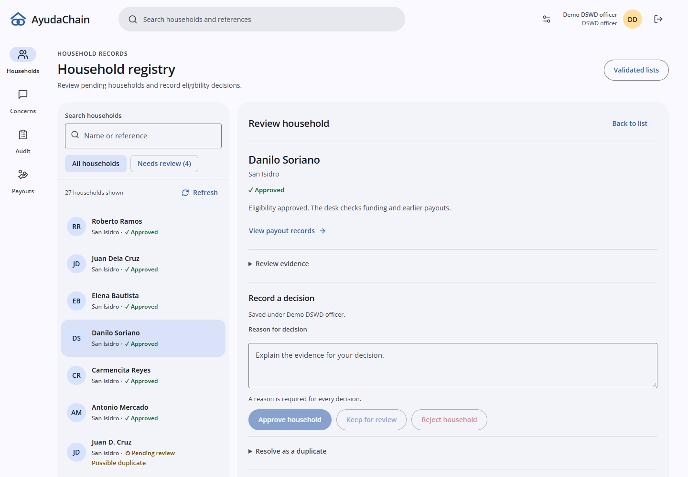
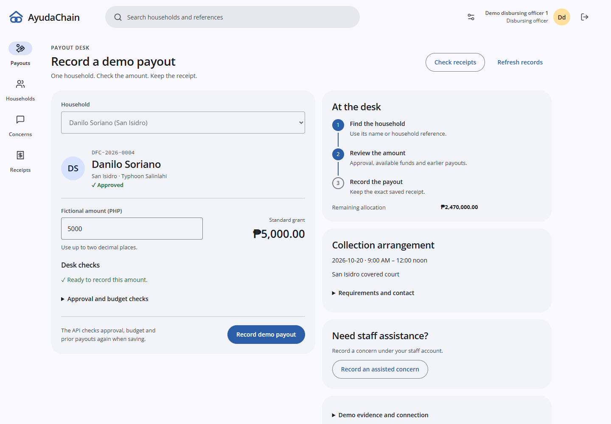
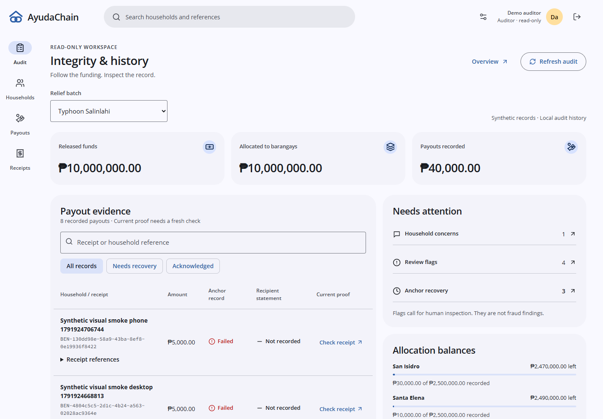
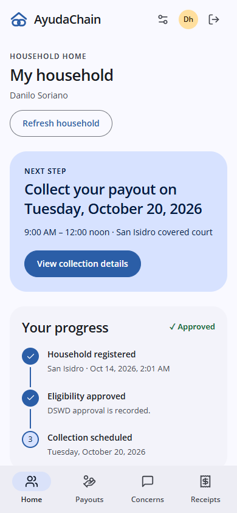
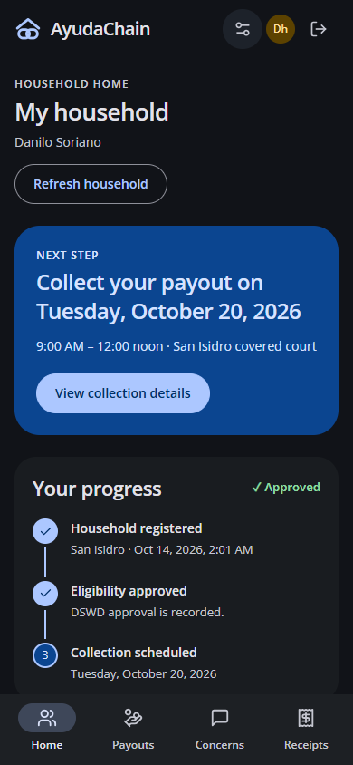
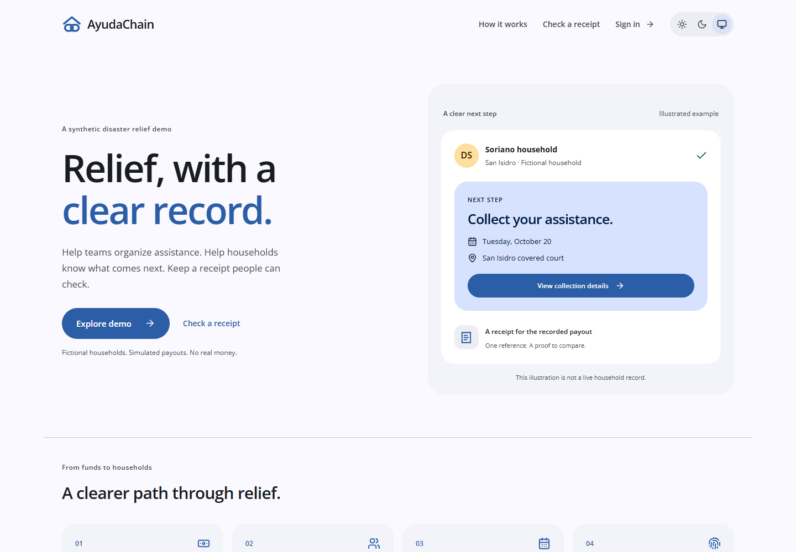

# Material frontend: actual rendered screens

The frontend now follows the groupmate's [Tonal Sea and Sun reference](https://github.com/andreirtc/ayudachain/blob/4377db103bb525b2d8c83746eda28b12473095ce/docs/design/tonal-design-reference.html) in its actual structure, typography and interactions. This is the successor to PR #38.

## Delivered screens

- Shared 80px desktop app bar and 96px icon rail; phones have a compact 64px bar and four-destination bottom navigation. A functional search opens permitted registry results or an exact receipt. Account information, sign-out and appearance controls stay available; private search text clears on account changes.
- The groupmate's Kubo Link mark, local Open Sans interface/heading font and Source Code Pro references are used consistently. Sea and Sun surface roles, restrained status words/glyphs, outlined fields, pill actions and visible focus apply to both themes. The old unused interface font preloads are removed.
- Registry review is a real list/detail workspace instead of a table opening a modal. Phones move from list to detail and back. Registration/CSV dialogs keep native keyboard behavior; decision reasons, permissions, histories and exact household links remain connected.
- Payout uses the tablet-style person/amount/check layout with a visible desk progression and collection context. Once-only submission, uncertain-response replay, receipt handoff and existing anchor recovery controls remain available. The layout does not introduce fake camera, identity-photo, PIN or checker capabilities.
- Audit uses a compact searchable/filterable table, real scoped household labels, actual allocation balances, an attention panel and expandable local history. Saved anchor state, recipient acknowledgement and a current proof are distinct.
- Household home starts with the actual next step, followed by recorded progress and collection/payout details. The collection action focuses the real details. Concerns use list/detail rows and retained staff responses with household redaction.
- Landing, sign-in, overview, batch, lists, arrangements and receipt verification use the same visual system. Overview has compact activity and a grounded role-specific action; batch allocations use a table; verification has separate receipt-selection and evidence panes.

The public landing illustration is explicitly labelled as an illustration. All operational content comes from the API. No API, database, receipt protocol, contract or anchor worker change is part of this frontend task.

## Screenshots from the working preview

These are actual browser captures at desktop1440x1000 and phone390x844. They use owned synthetic records and real authenticated APIs, not the reference's invented proof outcomes.

## Focused validation

Independent TypeScript and the isolated production build pass. Six existing navigation/offline-payout Node tests pass. A single full workflow passes at desktop and phone sizes: real registration, inline approval, guarded repeat click, server persistence followed by an intentionally lost response and safe replay, exact receipt navigation, audit search/filter, household concern redaction, collection focus and keyboard theme controls.

All main routes were visually walked and captured in 23 desktop/phone/light/dark observations without runtime errors or horizontal overflow. Captures and the two workflow results are retained under tmp/ayudachain-visual-redesign. Broader locator-heavy legacy browser, backend and contract suites were not rerun. The focused demo browser assertions were updated for the audit's new batch selector and current-proof explanation. Physical-device behavior, a full accessibility audit and human design acceptance are not claimed.

## Live evaluation

At the user's request the owned preview remains running on http://127.0.0.1:3101 with an isolated synthetic API on8101 and its own .next-visual-preview output. It contains a real finalized list/arrangement, own-household concern and staff reply, and recorded payout with a truthful unavailable-chain recovery state. It does not use the original database, chain8545 or frontend3000. Local synthetic accounts/password are those provisioned by backend/tests/e2e_server.py. Their credentials are only for this isolated evaluation fixture.

The preview is local to the current machine. Groupmates use the newest cumulative branch and the existing normal setup/account-provisioning steps; no hosting or production deployment is introduced. The temporary .next-material-qa production build is removed after validation.
